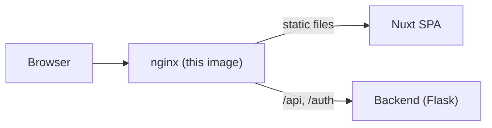
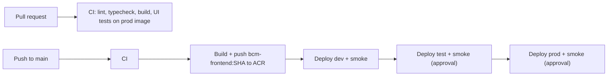

# BCM Tools — Frontend

Nuxt 4 single-page app for BCM Tools, built with Nuxt UI. In production it is served by nginx, which also forwards `/api/*` and `/auth/*` to the backend, so the browser only ever talks to one origin.

The backend (Flask API, Microsoft sign-in, Graph, MySQL) lives in a separate repository (`bcm-backend`).

---

## Contents

- [Tech stack](#tech-stack)
- [How it fits together](#how-it-fits-together)
- [Project structure](#project-structure)
- [Getting started](#getting-started)
- [Scripts](#scripts)
- [Configuration](#configuration)
- [Authentication in the frontend](#authentication-in-the-frontend)
- [Building pages](#building-pages)
- [Testing](#testing)
- [Docker images and nginx](#docker-images-and-nginx)
- [CI/CD](#cicd)
- [Azure setup](#azure-setup)
- [Compatibility with the backend](#compatibility-with-the-backend)
- [Troubleshooting](#troubleshooting)

---

## Tech stack

| Concern | Choice |
|---|---|
| Framework | Nuxt 4 (Vue 3, TypeScript), client-side rendering only (`ssr: false`) |
| UI | Nuxt UI 4 (Tailwind CSS 4) |
| Icons | Lucide, bundled locally via `@iconify-json/lucide` (no runtime calls to the Iconify API) |
| State | `useState` composables (add Pinia when state grows) |
| Tests | Playwright |
| Production server | nginx (`nginxinc/nginx-unprivileged`, non-root, port 8080) |

## How it fits together



- The app is pre-built into static files (`nuxt generate`). There is no Node server in production.
- All data comes from the backend over `/api/*`. The frontend never calls Microsoft Graph and never holds tokens; it relies on the backend's `HttpOnly` session cookie.
- Sign-in and sign-out are full-page navigations to `/auth/login` and `/auth/logout`, which the backend handles.
- Locally, the Nuxt dev server does the same proxying that nginx does in production.

## Project structure

```text
frontend/
├── app/
│   ├── app.vue                    # Root: <UApp><NuxtLayout><NuxtPage /></NuxtLayout></UApp>
│   ├── app.config.ts              # Nuxt UI theme (primary/neutral colours)
│   ├── error.vue                  # Full-page error screen (404, unhandled errors)
│   ├── assets/css/main.css        # Tailwind + Nuxt UI imports
│   ├── components/ProfileFields.vue # Label/value list used on the profile page
│   ├── composables/
│   │   ├── useAuth.ts             # Current user, fetchUser(), hasRole()
│   │   └── useProfile.ts          # GET /api/me/profile (Microsoft profile saved at sign-in); photo at /api/me/photo
│   ├── layouts/default.vue        # App shell: header with navigation, user name and sign-out
│   ├── middleware/auth.global.ts  # Redirects to /login unless the page is public
│   ├── pages/
│   │   ├── index.vue              # Home (requires sign-in)
│   │   ├── profile.vue            # The user's Microsoft profile from the backend's users table
│   │   └── login.vue              # Public sign-in page (no layout); shows sign-in errors and sign-out confirmation
│   └── types/page-meta.d.ts       # Adds `public` to definePageMeta
├── public/                        # Copied as-is: favicon.svg, robots.txt
├── e2e/
│   ├── ui/                        # Playwright tests with the API mocked
│   └── smoke/                     # Playwright tests against a real backend
├── nginx/default.conf.template    # Production nginx config (BACKEND_URL injected at start)
├── .github/workflows/             # ci.yml, deploy.yml, deploy-env.yml
├── compose.yaml                   # Local dev server with hot reload
├── Dockerfile                     # Targets: dev, build, prod
├── eslint.config.mjs              # ESLint (rules and code style set in nuxt.config.ts)
├── nuxt.config.ts
├── playwright.config.ts
├── .editorconfig, .nvmrc          # Editor settings; Node version used by CI
├── .env.example                   # Dev-only environment variables
└── package.json
```

Pages use `layouts/default.vue` unless they opt out with `definePageMeta({ layout: false })`, as `login.vue` does.

## Getting started

### Prerequisites

- Docker Desktop, **or** Node.js 24.11+ (`.nvmrc`; 22.21+ also works) with npm 11.5+. Docker and CI use Node 24; use npm 11 locally too, because npm 10's `npm ci` rejects lockfiles written by npm 11.
- The backend running locally on port 8000 (see the backend README)

> npm 11.4 has a bug that crashes `npm install` on this project (`Cannot read properties of null (reading 'edgesOut')`). Upgrade with `npm install -g npm@latest`, or run `npx npm@latest install`.

### Option A: Docker (recommended)

1. Start the backend stack (in the backend repository): `docker compose up`
2. Start the frontend:

   ```powershell
   docker compose up --build
   ```

3. Open <http://localhost:3000>. You'll be redirected to the login page; **Sign in with Microsoft** goes through the backend to Entra ID.

Source is bind-mounted, so edits hot-reload. File watching uses polling (`CHOKIDAR_USEPOLLING=true`) because Docker Desktop on Windows doesn't forward file-change events from the host.

The container reaches the backend at `http://host.docker.internal:8000`, so the backend can run in Docker or directly on your machine.

### Option B: Node on your machine

```powershell
npm install
npm run dev
```

The dev server runs on <http://localhost:3000> and proxies `/api` and `/auth` to `http://localhost:8000`. Point it elsewhere with `NUXT_DEV_BACKEND_URL`:

```powershell
$env:NUXT_DEV_BACKEND_URL = "http://localhost:8001"; npm run dev
```

## Scripts

| Command | What it does |
|---|---|
| `npm run dev` | Dev server with hot reload on port 3000 |
| `npm run build` | Static production build into `.output/public` (`nuxt generate`) |
| `npm run preview` | Preview the production build |
| `npm run lint` | ESLint, including code style (`npm run lint:fix` to auto-fix) |
| `npm run typecheck` | Type-check the app (`vue-tsc`) |
| `npm run test:e2e` | Playwright UI tests (API mocked) against `E2E_BASE_URL` |
| `npm run test:smoke` | Playwright smoke tests against a real backend at `E2E_BASE_URL` |

## Configuration

The built app has no environment-specific settings: the same image runs in every environment because all API calls are relative (`/api/...`). Environment differences live in nginx and the backend.

| Variable | Where | Default | Purpose |
|---|---|---|---|
| `BACKEND_URL` | Production container (runtime) | — (required) | Where nginx forwards `/api` and `/auth`, e.g. `https://bcm-api-prod.azurewebsites.net`. Scheme and host only, no path. |
| `APP_VERSION` | Docker build arg | `dev` | Written to `/version.json`; the deploy pipeline uses it to detect the new release. |
| `NUXT_DEV_BACKEND_URL` | Dev server | `http://localhost:8000` | Backend for the dev proxy. |
| `CHOKIDAR_USEPOLLING` | Dev server | unset | `true` to poll for file changes (needed for Docker on Windows). |
| `E2E_BASE_URL` | Playwright | `http://localhost:3000` | Site under test. |

## Authentication in the frontend

The backend owns authentication. The frontend only needs to know who the user is.

### `useAuth()`

```ts
const { user, fetchUser, hasRole } = useAuth()

user.value            // { id, name, email, roles } or null
await fetchUser()     // GET /api/me; sets user to null on 401, rethrows other errors
hasRole('BCM.Admin')  // true if the user has any of the given roles
```

### Route guard

`app/middleware/auth.global.ts` runs before every route. If no user is loaded it calls `/api/me`; on 401 it redirects to `/login?redirect=<original path>`. The login button sends that path to the backend as `next`, so users land back where they started after signing in.

Pages are protected by default. Make a page public with:

```vue
<script setup lang="ts">
definePageMeta({ public: true })
</script>
```

### Sign-in and sign-out

Sign-out ends only the BCM Tools session; the browser stays signed in to Microsoft. The backend then redirects to `/login?signed_out=1`, which shows a confirmation.

Use plain links — they must be full-page navigations, not client-side routes:

```vue
<UButton to="/auth/login" external label="Sign in with Microsoft" />
<UButton to="/auth/logout" external label="Sign out" />
```

### Role-based UI

```vue
<UButton v-if="hasRole('BCM.Admin')" label="Delete plan" color="error" />
```

Hiding UI is for usability only. The backend enforces every permission with `@require_role`.

## Building pages

### Calling the API

Use `$fetch` with relative URLs; the session cookie is sent automatically because everything is same-origin.

```ts
interface Plan { id: number; name: string }

const plans = await $fetch<Plan[]>('/api/plans')
await $fetch('/api/plans', { method: 'POST', body: { name: 'Data centre outage' } })
```

In components, `useFetch` gives you reactive loading and error state:

```vue
<script setup lang="ts">
const { data: plans, status, error, refresh } = await useFetch<Plan[]>('/api/plans')
</script>
```

If a session expires mid-use, API calls return 401. The route guard handles it on the next navigation; for long-lived screens, catch 401 and send the user to `/login`.

### Nuxt UI

Components are auto-imported with the `U` prefix (`UButton`, `UCard`, `UTable`, `UForm`, `UModal`, ...). See the [Nuxt UI docs](https://ui.nuxt.com/docs). Forms pair well with Zod for validation.

Icons use the Lucide set, bundled at build time so they work without internet access:

```vue
<UIcon name="i-lucide-shield-alert" />
<UButton icon="i-lucide-plus" label="New plan" />
```

To use another icon set, install its `@iconify-json/<set>` package — don't rely on the online Iconify API, which is blocked in the private network.

Every icon is compiled into the client bundle (`icon.clientBundle.scan` in `nuxt.config.ts`), because the static build has no `/api/_nuxt_icon` endpoint and nginx would send that path to the backend. Write icon names as literal strings (`'i-lucide-house'`) so the build can find them; names assembled at runtime won't be bundled.

## Testing

Playwright tests are split into two projects:

| Project | Folder | Backend | Runs in |
|---|---|---|---|
| `ui` | `e2e/ui/` | Mocked in the browser with `page.route` | CI on every pull request |
| `smoke` | `e2e/smoke/` | Real | After every deployment, and locally against the full stack |

### Running locally

```powershell
npx playwright install chromium        # first time only

# UI tests: need only the frontend on :3000 (dev server or prod image)
npm run test:e2e

# Smoke tests: need frontend + backend
npm run test:smoke

# Against a deployed environment
$env:E2E_BASE_URL = "https://bcm-dev.example.co.id"; npm run test:smoke

# Debugging
npx playwright test --project=ui --ui
npx playwright show-report
```

### Writing UI tests

Mock the backend so tests are fast and don't need Entra:

```ts
test('admins see the delete button', async ({ page }) => {
  await page.route('**/api/me', (route) =>
    route.fulfill({ json: { id: 'u1', name: 'Admin', email: 'a@example.com', roles: ['BCM.Admin'] } }),
  )
  await page.route('**/api/plans', (route) => route.fulfill({ json: [{ id: 1, name: 'Plan A' }] }))

  await page.goto('/plans')
  await expect(page.getByRole('button', { name: 'Delete plan' })).toBeVisible()
})
```

Prefer role- and text-based locators (`getByRole`, `getByText`) over CSS selectors.

Smoke tests must not depend on a signed-in user: real Entra sign-in (MFA, conditional access) can't be automated reliably.

## Docker images and nginx

`Dockerfile` targets:

| Target | Base | What it does |
|---|---|---|
| `dev` | `node:24-alpine` | `nuxt dev` on port 3000 (used by `compose.yaml`) |
| `build` | `node:24-alpine` | `npm ci`, `nuxt generate`, writes `version.json` |
| `prod` | `nginxinc/nginx-unprivileged:1.27-alpine` | Serves `.output/public` on port 8080 as a non-root user |

Run the production image locally against a backend on your machine:

```powershell
docker build --target prod --build-arg APP_VERSION=local -t bcm-frontend .
docker run --rm -p 3000:8080 --add-host host.docker.internal:host-gateway `
  -e BACKEND_URL=http://host.docker.internal:8000 bcm-frontend
```

### nginx behaviour (`nginx/default.conf.template`)

- **SPA fallback**: unknown paths serve `index.html`, so deep links work. Pre-rendered pages such as `/login` are served from `login/index.html` directly.
- **Relative redirects** (`absolute_redirect off`): nginx never builds redirects with its internal port 8080.
- **Proxy**: `/api/*` and `/auth/*` go to `BACKEND_URL`. The upstream `Host` header is the backend's own host (required by App Service routing), with the original host in `X-Forwarded-Host`. SNI is enabled for HTTPS upstreams. `X-Forwarded-Proto` is passed through from the load balancer.
- **Compression**: gzip for JS, CSS, JSON and SVG over 1 KB.
- **Caching**: hashed assets under `/_nuxt/` are cached for 1 year; HTML and `version.json` are `no-cache`, so a new release is picked up immediately.
- **Security headers**: `X-Content-Type-Options: nosniff`, `X-Frame-Options: DENY`, `Referrer-Policy: strict-origin-when-cross-origin`.
- **Upload limit**: 20 MB request bodies.

`BACKEND_URL` is substituted when the container starts (nginx's built-in template processing). nginx resolves the backend hostname once at startup, so restart the frontend if the backend's address changes.

## CI/CD



| Workflow | Trigger | What it does |
|---|---|---|
| `ci.yml` | Pull requests; called by `deploy.yml` | `npm ci`, lint, typecheck, build; then builds the **prod** image, runs it, and runs the Playwright `ui` project against it |
| `deploy.yml` | Push to `main`, manual | Runs CI, builds the image once, tagged with the commit SHA, pushes to ACR, then promotes the **same image** through `dev`, `test`, `prod` |
| `deploy-env.yml` | Called per environment | Points the App Service at the new image, waits until `APP_URL/version.json` reports the new SHA, then runs the Playwright `smoke` project against `APP_URL` |

### GitHub configuration

Azure login uses OpenID Connect (federated credentials) — no Azure secrets in GitHub.

**Repository variables:**

| Variable | Purpose |
|---|---|
| `AZURE_TENANT_ID` | Tenant of the deployment identity |
| `AZURE_SUBSCRIPTION_ID` | Subscription containing the resources |
| `AZURE_CLIENT_ID` | Identity used by the build job to push to ACR |
| `ACR_NAME` | Container registry name (without `.azurecr.io`) |
| `DEPLOY_RUNNER` | Label of the self-hosted runner inside the VNet (empty = `ubuntu-latest`) |

**Environments** `dev`, `test`, `prod`, each with:

| Variable | Example | Purpose |
|---|---|---|
| `AZURE_CLIENT_ID` | | Deployment identity for this environment |
| `FRONTEND_APP_NAME` | `bcm-web-dev` | App Service name |
| `APP_URL` | `https://bcm-dev.example.co.id` | Public URL of the app, reachable from the runner. Used for the version check and smoke tests; leave empty to skip both |

Protection rules: require reviewers on `test` and `prod`; restrict `prod` to `main`.

The self-hosted runner (shared with the backend repository) needs Docker, Azure CLI, `curl` and Node.js 24, plus the OS libraries Playwright installs with `npx playwright install --with-deps`.

## Azure setup

Per environment:

| Resource | Notes |
|---|---|
| App Service (Linux, container) | e.g. `bcm-web-<env>`. Private endpoint for inbound (reached via Application Gateway); VNet integration for outbound to the backend's private endpoint. |
| Application Gateway with WAF | Public or internal entry point for users; TLS termination; routes to the frontend App Service. Its hostname is the `PUBLIC_BASE_URL` configured on the backend. |

### App Service settings

| Setting | Value |
|---|---|
| `WEBSITES_PORT` | `8080` |
| `BACKEND_URL` | Backend App Service URL, e.g. `https://bcm-api-dev.azurewebsites.net` (resolves to its private endpoint through private DNS) |

Also give the App Service a managed identity with *AcrPull* on the registry, enable managed-identity ACR pull, and set the health check path to `/`.

### Deployment identity

As for the backend: a managed identity per environment with a federated credential for `repo:<org>/<frontend-repo>:environment:<env>` (and `ref:refs/heads/main` for the build identity), with *AcrPush* (build) and *Website Contributor* on the frontend App Service (environments).

## Compatibility with the backend

The two repositories deploy independently, so the frontend must cope with the backend being one release ahead or behind:

- Treat new response fields as optional until the backend that provides them is in `prod`.
- Ship backend changes first (new endpoints/fields), then the frontend that uses them.
- Don't rely on a field being removed; the backend removes fields only after the frontend stops using them.

## Troubleshooting

| Symptom | Cause and fix |
|---|---|
| `npm install` fails with `reading 'edgesOut'` | npm 11.4 bug. Run `npm install -g npm@latest`, or `npx npm@latest install`. |
| Hot reload doesn't pick up changes in Docker | Polling must be enabled (`CHOKIDAR_USEPOLLING=true`, already set in `compose.yaml`). The project folder being synced by OneDrive can also slow down watching. |
| `/api/...` returns 502/504 locally | The backend isn't running on port 8000, or `NUXT_DEV_BACKEND_URL` / `BACKEND_URL` points to the wrong place. |
| Login page loops back to `/login?error=signin_failed` | A backend sign-in problem — check the backend logs and its README's troubleshooting section. |
| Production container exits at start with `host not found in upstream` | nginx can't resolve `BACKEND_URL`. Check the value, and in Azure the private DNS zone for the backend's private endpoint. |
| Production App Service returns 404 from `/api` | The upstream `Host` must be the backend's hostname. Don't override `proxy_set_header Host` in the nginx template. |
| Icons missing | The icon set isn't installed locally. Install `@iconify-json/<set>`. |
| Playwright: `browserType.launch: Executable doesn't exist` | Run `npx playwright install chromium`. |
