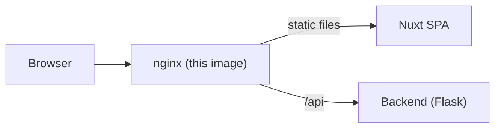
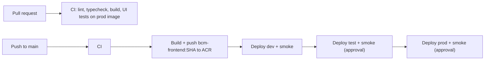

# BCM Tools — Frontend

Nuxt 4 single-page app for BCM Tools, built with Nuxt UI. In production it is served by nginx, which also forwards `/api/*` to the backend, so the browser only ever talks to one origin.

The backend (Flask API, ID-and-password sign-in, roles and menus, SMTP email, MySQL) lives in a separate repository (`bcm-backend`).

---

## Contents

- [Tech stack](#tech-stack)
- [How it fits together](#how-it-fits-together)
- [Project structure](#project-structure)
- [Getting started](#getting-started)
- [Scripts](#scripts)
- [Configuration](#configuration)
- [Authentication in the frontend](#authentication-in-the-frontend)
- [Building pages](#building-pages)
- [SCCA](#scca)
- [Testing](#testing)
- [Docker images and nginx](#docker-images-and-nginx)
- [CI/CD](#cicd)
- [Azure setup](#azure-setup)
- [Compatibility with the backend](#compatibility-with-the-backend)
- [Troubleshooting](#troubleshooting)

---

## Tech stack

| Concern | Choice |
|---|---|
| Framework | Nuxt 4 (Vue 3, TypeScript), client-side rendering only (`ssr: false`) |
| UI | Nuxt UI 4 (Tailwind CSS 4), themed by the [design system](docs/design-system.md) |
| Font | Inter, self-hosted via `@fontsource-variable/inter` (no Google Fonts) |
| Icons | Lucide, bundled locally via `@iconify-json/lucide` (no runtime calls to the Iconify API) |
| State | `useState` composables (add Pinia when state grows) |
| Tests | Playwright |
| Production server | nginx (`nginxinc/nginx-unprivileged`, non-root, port 8080) |

## How it fits together



- The app is pre-built into static files (`nuxt generate`). There is no Node server in production.
- All data comes from the backend over `/api/*`. The frontend never holds tokens or passwords after sign-in; it relies on the backend's `HttpOnly` session cookie and sends the session's CSRF token on every write.
- Sign-in is a form on `/login` that posts the ID (email) and password to `POST /api/auth/login`.
- **The menu comes from the database.** `GET /api/me/menu` returns the items the user's roles allow; the sidebar and the home page render it.
- Locally, the Nuxt dev server does the same proxying that nginx does in production.

## Project structure

```text
frontend/
├── app/
│   ├── app.vue                    # Root: <UApp><NuxtLayout><NuxtPage /></NuxtLayout></UApp>
│   ├── app.config.ts              # Nuxt UI theme: colour aliases, compact tables
│   ├── error.vue                  # Full-page error screen (404, unhandled errors)
│   ├── assets/css/main.css        # Design tokens: CIMB palette, chart palette, Inter, motion
│   ├── components/
│   │   ├── AppChart.vue           # Chart card: title, summary, "View as table", loading/empty, fixed height (ECharts)
│   │   ├── AppLogo.vue            # CIMB Niaga logo + "BCM Tools", top of the sidebar
│   │   ├── AppPage.vue            # Page frame: navbar (title, icon, actions, bell, user menu); breadcrumbs; <main>
│   │   ├── AuthShell.vue          # Brand panel + card for sign-in, forgot, reset and set-password pages
│   │   ├── ChangePasswordForm.vue, PasswordRules.vue  # Password change form and live rule checklist
│   │   ├── NotificationsMenu.vue  # Navbar bell and panel (placeholder: "Coming soon", empty state)
│   │   ├── UserMenu.vue           # Navbar, top right: avatar, name, roles; Profile, Change password, Sign out
│   │   ├── UserPicker.vue         # Search /api/users and pick a user by id (`permission` filters, e.g. scca.access)
│   │   ├── admin/                 # AdminUserForm, AdminPasswordDialog, AdminMenuForm, MenuRowActions;
│   │   │                          # scca-config/: Versions, Lists, Questions, Steps, Formula, Notes, Reminders, Changes
│   │   ├── StatusBadge.vue        # Renders a value from a status scale (label, colour, icon)
│   │   ├── TablePagination.vue    # Table footer: "Showing x–y of z" + pager (URL `to` or v-model:page)
│   │   ├── ProfileFields.vue      # Label/value list used on the profile page
│   │   └── scca/                  # SccaRecord, SccaReport, SccaResolve; one Scca*Form.vue per tab, SccaMatrix, SccaReportDownloads,
│   │                              # charts (SccaBarChart, SccaLineChart), BCM board dialogs
│   ├── charts/echarts.ts          # ECharts parts + `bcm` theme; loaded on demand by AppChart
│   ├── composables/
│   │   ├── useAuth.ts             # Current user, menu, login(), logout(), changePassword(), can(), hasRole()
│   │   ├── useAdmin.ts            # Administration types, adminApi, status scales, labels
│   │   ├── useNotifications.ts    # Notification type and unread count; empty until the backend serves them (see the file)
│   │   ├── useProfile.ts          # GET /api/me/profile; photo at /api/me/photo (upload with PUT)
│   │   ├── useScca.ts             # SCCA types, list/detail/config fetchers, mutations, report URLs, 422 field errors
│   │   ├── useSccaConfigAdmin.ts  # Administration > SCCA configuration: versions, edits, publish, signers
│   │   └── useSccaWorkflow.ts     # SCCA monitoring, approval inbox/history/board, reminder rules
│   ├── layouts/default.vue        # App shell: collapsible sidebar built from GET /api/me/menu
│   ├── middleware/auth.global.ts  # Sign-in, forced password change, and each page's `permission`
│   ├── plugins/api.client.ts      # Adds X-CSRF-Token to writes; 401 → sign-in, password_change_required → /account/password
│   ├── pages/
│   │   ├── index.vue              # Home: greeting, roles, approvals waiting, modules from the menu
│   │   ├── profile.vue            # The user's record, roles, photo upload
│   │   ├── login.vue, forgot-password.vue, reset-password.vue  # Public pages (no layout)
│   │   ├── account/password.vue   # Change password (forced after a temporary password)
│   │   ├── forbidden.vue          # Shown when a page's permission is missing
│   │   ├── admin/                 # users, roles, menus, settings/email, scca-config, audit (settings/scca opens its Reminders tab)
│   │   └── scca/                  # {monitoring,manage,approval}/index.vue, …/[id]/index.vue + report.vue, manage/new.vue; [id] resolvers
│   ├── types/page-meta.d.ts       # Adds `public` and `permission` to definePageMeta
│   └── utils/                     # Auto-imported: format.ts (id-ID dates/numbers/Rp, WIB), chart.ts, status.ts,
│                                  # scca.ts (SCCA constants, gap checks, workbook notes), scca-config.ts
│                                  # (a version's lists, steps, notes; label registry), menu-icons.ts
├── docs/design-system.md          # Design system spec: tokens, components, accessibility, writing style
├── public/                        # Copied as-is: cimb-niaga-logo.svg, favicon.ico
├── e2e/
│   ├── ui/                        # Playwright tests with the API mocked
│   └── smoke/                     # Playwright tests against a real backend
├── nginx/default.conf.template    # Production nginx config (BACKEND_URL injected at start)
├── .github/workflows/             # ci.yml, deploy.yml, deploy-env.yml
├── compose.yaml                   # Local dev server with hot reload
├── Dockerfile                     # Targets: dev, build, prod
├── eslint.config.mjs              # ESLint (rules and code style set in nuxt.config.ts)
├── nuxt.config.ts
├── playwright.config.ts
├── .editorconfig, .nvmrc          # Editor settings; Node version used by CI
├── .env.example                   # Dev-only environment variables
└── package.json
```

### Naming conventions

| What | Convention | Example |
|---|---|---|
| Components | `PascalCase.vue`; a feature folder's components start with the feature name, so Nuxt's auto-import name is the file name | `components/scca/SccaRatingForm.vue` → `<SccaRatingForm>` |
| Tab or edit forms | `<Feature><Thing>Form.vue` | `SccaInterdependencyForm.vue` |
| Shared, feature-free components | at the root of `components/` | `UserPicker.vue`, `StatusBadge.vue` |
| Composables | `use<Feature>.ts`, one per feature | `useScca.ts` |
| Utils | lower-case feature or concern name | `utils/scca.ts`, `utils/format.ts` |
| Pages and routes | lower-case, nested by feature; `[id]` for a record | `pages/scca/monitoring/[id]/report.vue` → `/scca/monitoring/1/report` |
| Constants | `SCREAMING_SNAKE_CASE`, prefixed with the feature | `SCCA_DEPLOYMENT_MODELS` |
| UI tests | `e2e/ui/<feature>[-<area>].spec.ts`; mocks in `e2e/fixtures/<feature>.ts` | `e2e/ui/scca.spec.ts`, `e2e/ui/scca-approval.spec.ts` |

Values sent to the API (deployment model, business hours, recovery hours, ...) are the same lists as the backend's `app/models/scca.py`; keep both in step. All text files use LF line endings (`.gitattributes`).

Pages use `layouts/default.vue` and wrap their content in `<AppPage title="...">`, unless they opt out with `definePageMeta({ layout: false })`, as `login.vue` does.

**Before building UI, read [`docs/design-system.md`](docs/design-system.md).** It defines colours, typography, spacing, and how to use buttons, forms, tables, feedback, status badges, KPI tiles, charts and navigation.

## Getting started

### Prerequisites

- Docker Desktop, **or** Node.js 24.11+ (`.nvmrc`; 22.21+ also works) with npm 11.5+. Docker and CI use Node 24; use npm 11 locally too, because npm 10's `npm ci` rejects lockfiles written by npm 11.
- The backend running locally on port 8000 (see the backend README)

> npm 11.4 has a bug that crashes `npm install` on this project (`Cannot read properties of null (reading 'edgesOut')`). Upgrade with `npm install -g npm@latest`, or run `npx npm@latest install`.

### Option A: Docker (recommended)

1. Start the backend stack (in the backend repository): `docker compose up`
2. Start the frontend:

   ```powershell
   docker compose up --build
   ```

3. Open <http://localhost:3000>. You'll be redirected to the login page. Sign in with the first Administrator: the backend log prints its temporary password the first time it starts (`BOOTSTRAP_ADMIN_EMAIL`); you set your own password right after.

Source is bind-mounted, so edits hot-reload. File watching uses polling (`CHOKIDAR_USEPOLLING=true`) because Docker Desktop on Windows doesn't forward file-change events from the host.

The container reaches the backend at `http://host.docker.internal:8000`, so the backend can run in Docker or directly on your machine.

### Option B: Node on your machine

```powershell
npm install
npm run dev
```

The dev server runs on <http://localhost:3000> and proxies `/api` to `http://localhost:8000`. Point it elsewhere with `NUXT_DEV_BACKEND_URL`:

```powershell
$env:NUXT_DEV_BACKEND_URL = "http://localhost:8001"; npm run dev
```

#### Opening it from another device on the same Wi-Fi

`npm run dev` listens on every network interface, so a phone or another laptop on the same Wi-Fi can open the app. Use `npm run dev:local` instead to keep it on this computer only (for example on public Wi-Fi).

1. Find this computer's address: run `ipconfig` and copy the **IPv4 Address** under "Wireless LAN adapter Wi-Fi" (for example `192.168.1.23`). Nuxt also prints it as the **Network:** URL when it starts.
2. On the other device open `http://<that address>:3000`, with `http` and `:3000`.
3. If it doesn't load there, allow port 3000 through Windows Firewall once, in PowerShell as administrator (use your Wi-Fi's name from `ipconfig` if it isn't "Wi-Fi"):

   ```powershell
   Set-NetConnectionProfile -InterfaceAlias "Wi-Fi" -NetworkCategory Private
   New-NetFirewallRule -DisplayName "BCM Tools dev 3000" -Direction Inbound -Protocol TCP -LocalPort 3000 -Action Allow -Profile Private
   ```

Only port 3000 needs to be reachable: the dev server forwards `/api` to the backend on this computer. Sign-in works over plain `http` as long as the backend's `APP_ENV` is a development value; a deployed value makes the session cookie https-only. Office and guest Wi-Fi often block devices from reaching each other; if it works on a phone hotspot but not on the office Wi-Fi, that's the reason.

## Scripts

| Command | What it does |
|---|---|
| `npm run dev` | Dev server with hot reload on port 3000, reachable from other devices on the same network |
| `npm run dev:local` | Same, but only reachable from this computer |
| `npm run build` | Static production build into `.output/public` (`nuxt generate`) |
| `npm run preview` | Preview the production build |
| `npm run lint` | ESLint, including code style (`npm run lint:fix` to auto-fix) |
| `npm run typecheck` | Type-check the app (`vue-tsc`) |
| `npm run test:e2e` | Playwright UI tests (API mocked) against `E2E_BASE_URL` |
| `npm run test:smoke` | Playwright smoke tests against a real backend at `E2E_BASE_URL` |

## Configuration

The built app has no environment-specific settings: the same image runs in every environment because all API calls are relative (`/api/...`). Environment differences live in nginx and the backend.

| Variable | Where | Default | Purpose |
|---|---|---|---|
| `BACKEND_URL` | Production container (runtime) | — (required) | Where nginx forwards `/api`, e.g. `https://bcm-api-prod.azurewebsites.net`. Scheme and host only, no path. |
| `APP_VERSION` | Docker build arg | `dev` | Written to `/version.json`; the deploy pipeline uses it to detect the new release. |
| `NUXT_DEV_BACKEND_URL` | Dev server | `http://localhost:8000` | Backend for the dev proxy. |
| `CHOKIDAR_USEPOLLING` | Dev server | unset | `true` to poll for file changes (needed for Docker on Windows). |
| `E2E_BASE_URL` | Playwright | `http://localhost:3000` | Site under test. |

## Authentication in the frontend

The backend owns authentication and access. The frontend signs in with a form, keeps the user and their permissions, and hides what the user can't use.

### `useAuth()`

```ts
const { user, menu, login, logout, changePassword, can, hasRole } = useAuth()

user.value                 // { id, username, name, email, roles: [{ code, name }], permissions, must_change_password, csrf_token } or null
await login(id, password)  // POST /api/auth/login
await logout()             // POST /api/auth/logout
can('scca.create')         // true if the user's roles grant any of the given permission codes
menu.value                 // GET /api/me/menu: the sidebar tree the user may see
```

### Pages, permissions and the route guard

`app/middleware/auth.global.ts` runs before every route:

1. No user loaded → `GET /api/me`; on 401 → `/login?redirect=<original path>`.
2. `must_change_password` → `/account/password` until a new password is set.
3. The page's `permission` is missing → `/forbidden`.

```vue
<script setup lang="ts">
definePageMeta({ permission: 'scca.create' })  // any of several: permission: ['a', 'b']
</script>
```

Public pages (sign-in, forgot and reset password) use `definePageMeta({ public: true, layout: false })`.

### Sign-in, password reset and CSRF

- `/login` posts `{ username, password }`. Wrong ID or password, a locked account (5 failures, 15 minutes) and rate limits each show their own message.
- `/forgot-password` emails a reset link (30 minutes); `/reset-password?token=` sets the new password. Administrators' invitation emails use the same page (72 hours).
- `plugins/api.client.ts` wraps `window.fetch`, so every `$fetch`/`useFetch` write to `/api/*` carries `X-CSRF-Token` from the session, and a 401 sends the user back to sign in.

### Menus and role-based UI

The sidebar (`layouts/default.vue`) and the home page's modules come from `GET /api/me/menu`; administrators edit labels, icons, order, visibility and the needed permission in **Administration > Menus**. Icons must be in `utils/menu-icons.ts` (they are bundled at build time).

```vue
<UButton v-if="can('scca.create')" to="/scca/manage/new" label="New assessment" />
```

Hiding UI is for usability only. The backend enforces every permission with `@require_permission`.

### Administration

| Page | Permission | What it does |
|---|---|---|
| `/admin/users` | `admin.users.manage` | Users: create (invitation email or temporary password), edit, roles, deactivate, unlock, reset password |
| `/admin/roles` | `admin.roles.manage` | Roles and the permissions they grant |
| `/admin/menus` | `admin.menus.manage` | Sidebar items: rename, icon, order, hide, needed permission, add links |
| `/admin/settings/email` | `admin.settings.mail` | SMTP providers (Gmail, Resend or another server): add or edit them (passwords and API keys stored encrypted), test one, choose the active one |
| `/admin/audit` | `admin.audit.view` | Tabs: sign-in and admin events; **SCCA activity** (who created, edited, rated, submitted, approved, rejected, commented on or downloaded each SCCA, with what changed; search by ref. no., application or user; `?tab=scca&assessment=ID` shows one assessment, linked from its **Activity** button); email outbox with "Send again" |

## SCCA

System Criticality Categorisation Assessment, matching the workbook *SCCA Tools V4.2 for CIMB Niaga*. The pages call `/api/scca/*`. The SCCA menu has three sections, and **each has its own record page** (`components/scca/SccaRecord.vue` with a `section`; rules in `utils/scca-sections.ts`):

| Page | Permission | What it does |
|---|---|---|
| `/scca/monitoring` | `scca.access` | Every SCCA with `scca.monitor` (BCM, management); otherwise the SCCAs you assess, contribute to or sign. Filter bar kept in the URL (period, category, application state, department, search). Tabs: **Overview** (KPI cards that open the view they count, applications by final category, SCCAs finalised per month: `SccaBarChart.vue`, `SccaLineChart.vue` in `AppChart` cards, each with a summary sentence and *View as table*), **Renewals** (overdue, due in 30 and 90 days, and whether a renewal is started), **Register** (one row per application with its SCCA history), **Bottlenecks** (steps waiting longest, average working days per step). Each tab has **Export to Excel** (`/api/scca/monitoring/<view>.xlsx` with the same filters) |
| `/scca/manage` | `scca.access` | **Drafts only** that I assess or contribute to (`mine=1&status=draft`, rejected ones included): my role, category so far, next step. **New assessment** (`/scca/manage/new`, `scca.create`) |
| `/scca/approval` | `scca.access` | **My inbox** (steps waiting for me, working days waiting, reminders, escalation; *Coming up*: SCCAs that will reach me), **My history** (my decisions and approvals made on my behalf), **BCM board** (`scca.approval.manage`: every pending step; *Act*: send a reminder now, reassign the step (`SccaReassignDialog.vue`), approve on behalf with a reason and evidence (`SccaOnBehalfDialog.vue`); not on SCCAs you assess or contribute to) |
| `/scca/manage/{id}` | editor of a draft | The editable SCCA. **Save** for the open tab is in the top bar next to View report ("Save application", "Save ratings", …), with an *Unsaved changes* badge; it submits that tab's form by id (`<button form="scca-form-<tab>">`, spinner via `sccaSavingKey`). **Submit for approval** is on Result and sign-off. New assessment keeps *Create assessment* under its form |
| `/scca/approval/{id}` | can act on it | In approval: read-only tabs, the decision panel (**Approve / Reject**) above them, review comments on each tab |
| `/scca/monitoring/{id}` | can view it | Read-only, with **Start renewal** on a final SCCA (the new draft opens in Manage). Comments are shown, never written. An approver viewing it here gets **Open in Approval** |
| `/scca/{id}` and `/scca/{id}/report` | | Resolvers (`SccaResolve.vue`) for emails, the audit log and old links: they open the reader's section. `/scca` → Manage, `/scca?view=waiting` → the Approval inbox, `/scca/new` → `/scca/manage/new` |
| `/admin/scca-config` | `scca.config.view` | **SCCA configuration** by version (`?version=`, default the draft, else the active one; `?tab=`). Tabs: **Versions** (status, SCCAs on each, name, notes, renewal period), **Lists** (the 13 choice lists: code, label, report text, rules, active, order), **Questions and guides**, **Sign-off steps** (order, required, signer mode, roles, Excel box, comments on every tab), **Formula** (weight sets, CIA mix, levels, matrix, recovery standards; calculator; impact on the active version's SCCAs), **Rating notes**, **Reminders and escalation** (`scca.settings.manage`; live rules, not versioned: reminder days, escalation day and extra addresses, renewal notice days, overdue repeat, sending window; `/admin/settings/scca` opens it), **Changes** (diff against the version it was copied from). On **Sign-off steps**, a default or fixed step has its signer picker under it (saved at once, for every version). Only the draft is editable (`scca.config.manage`); **Request publish**, then someone else with `scca.config.publish` **publishes** it |

An SCCA's section (`sccaSectionFor`): **Manage** while it is a draft you edit; **Approval** while it is in approval and you decide, may comment, or run the BCM board (and don't assess it); **Monitoring** otherwise. Opened in the wrong section, a record page moves to the right one and keeps `?tab=` (except an approver in Monitoring, who stays read-only). Each section stays highlighted in the sidebar on its record pages.

Monitoring, approval and settings types and fetchers are in `composables/useSccaWorkflow.ts`; working days are Monday to Friday. **Every list is server-paginated**, 25 rows a page (Coming up: 10): search `q`, filters, `page` and `per_page` are sent to the API, which returns one page with `total` and `pages`. On list pages (Manage, Monitoring's Renewals, Register and Bottlenecks, Approval's My inbox, My history and BCM board) the page and filters are kept in the URL (`?page=2`, `?coming=2`, `?decision=`, `?step=`). The footer is `TablePagination.vue`: "Showing x–y of z" and the pager, also used by Users and the Audit log tabs.

The editor has five tabs, one per part of the workbook. Each tab is one form component in `components/scca/`:

| Tab | Workbook sheet | Component |
|---|---|---|
| Application | `SCC_Rating` header, `SCC_Result` application details | `SccaDetailsForm.vue` |
| Rating | `SCC_Rating` (18 questions, guides, justification) | `SccaRatingForm.vue` |
| Interdependencies | `A3 Interdependency` | `SccaInterdependencyForm.vue` |
| Recovery | `SCC_Result` recovery blocks | `SccaRecoveryForm.vue` |
| Result and sign-off | `SCC_Result` scores, upgrade/downgrade, 8 sign-offs | `SccaResultForm.vue` |

**Configuration by version.** Every chooser, the questions and guides, the sign-off steps, the rating notes, the renewal period and the formula come from the SCCA's own configuration version (`GET /api/scca/config?version=`). `SccaRecord.vue` loads it with `useSccaConfig(assessment.formula_version)` and provides it (`sccaConfigKey`); the tab forms read it with `useSccaConfigContext()` and build their selects with `sccaListOptions()` (active items, plus a retired value the SCCA already stores, marked "(retired)"). A new assessment uses the active version. The V4.2 constants in `utils/scca.ts` remain the fallback. A loaded configuration also fills a label registry (`utils/scca-config.ts`), so step titles and list labels on lists, the approval board and the audit log follow the configuration. A draft on an older version shows **Move to V4.x** (`POST .../move-version`); the toast lists what has to be redone.

**Scoring stays on the backend.** The Rating tab previews through `POST /api/scca/calculate` and shows C, I, A, CIA with its level (`5-CIA`), Potential Loss with its level (`4-PoLoss`) and the category, the same figures as the workbook. The workbook's notes on C1 (C5 and P4 follow a Critical C1), A3 (highest category among *Full* dependencies) and I4 (number of interfaces) appear as warnings under those questions; like the workbook, they don't block saving (`ratingNoteWarnings()` in `utils/scca.ts`).

**Access and approval.** The API sends `permissions` and `my_role` with every assessment and the pages follow them: outside Manage, or without `can_edit`, the forms are wrapped in a disabled `<fieldset>`, the **Save buttons are hidden**, and a banner says why.

- *New assessment*: **Application name** (`SccaApplicationSearch.vue`) searches the applications already assessed (`GET /api/scca/applications`, name or code) or takes a new name. Picking one copies the header of its last SCCA (code, description, owner, IT support, stakeholders, country, vendor, deployment, customer facing, business days and hours), sets the reason to *Annual review*, and warns when that application still has an SCCA in draft or in approval.
- *Application* tab: **Contributor** picker (`UserPicker.vue`, searches `/api/users` and stores the user id). Only the assessor can change it.
- *Result and sign-off* tab: one `UserPicker` per sign-off step of the SCCA's version (V4.2: 9, including **BCM Reviewer** after IT Support PIC); designation and sub-directorate come from the user's profile. An *Optional* step can stay empty (skipped, "Not required"); a *default* step is filled in from the signer picked on the Sign-off steps tab; a *fixed* step shows its signer, locked, and is applied at Submit (it is not sent on save). `SccaApprovalPanel.vue` has Submit for approval (Manage), Approve / Reject with a note for the current approver (Approval), and the history; `:actions="false"` in Monitoring. There is **no recall**: once submitted, only a rejection returns the SCCA to draft.
- `SccaTabComments.vue` sits on top of every tab: during approval the approvers can comment on Result and sign-off; the other tabs only the BCM reviewer, at the BCM reviewer step (`permissions.comment_tabs`). The assessor and contributor read the comments but can't add any; `readonly` (Monitoring) never shows the box.
- A step approved by BCM on someone's behalf shows "on behalf, by X" and a link to the evidence, on the record and in both reports. A renewal links to the SCCA it renews; a final SCCA links to its renewal.

**Reports.** **View report** on every record opens its report page (`SccaReport.vue`). Once the SCCA is **final**, the report page (only) shows **Download PDF** and **Download Excel** (`SccaReportDownloads.vue`). They link to `GET /api/scca/assessments/{id}/report.pdf` and `.xlsx`: the backend fills the official workbook (formulas, charts and tick boxes kept) and lays out the PDF like the workbook's print. The backend refuses (409) a report for an assessment that is not final.

## Building pages

### Calling the API

Use `$fetch` with relative URLs; the session cookie is sent automatically because everything is same-origin.

```ts
interface Plan { id: number; name: string }

const plans = await $fetch<Plan[]>('/api/plans')
await $fetch('/api/plans', { method: 'POST', body: { name: 'Data centre outage' } })
```

In components, `useFetch` gives you reactive loading and error state:

```vue
<script setup lang="ts">
const { data: plans, status, error, refresh } = await useFetch<Plan[]>('/api/plans')
</script>
```

If a session expires mid-use, API calls return 401. The route guard handles it on the next navigation; for long-lived screens, catch 401 and send the user to `/login`.

### Nuxt UI

Components are auto-imported with the `U` prefix (`UButton`, `UCard`, `UTable`, `UForm`, `UModal`, ...). See the [Nuxt UI docs](https://ui.nuxt.com/docs). Forms pair well with Zod for validation.

Icons use the Lucide set, bundled at build time so they work without internet access:

```vue
<UIcon name="i-lucide-shield-alert" />
<UButton icon="i-lucide-plus" label="New plan" />
```

To use another icon set, install its `@iconify-json/<set>` package — don't rely on the online Iconify API, which is blocked in the private network.

Every icon is compiled into the client bundle (`icon.clientBundle.scan` in `nuxt.config.ts`), because the static build has no `/api/_nuxt_icon` endpoint and nginx would send that path to the backend. Write icon names as literal strings (`'i-lucide-house'`) so the build can find them; names assembled at runtime won't be bundled.

## Testing

Playwright tests are split into two projects:

| Project | Folder | Backend | Runs in |
|---|---|---|---|
| `ui` | `e2e/ui/` | Mocked in the browser with `page.route` | CI on every pull request |
| `smoke` | `e2e/smoke/` | Real | After every deployment, and locally against the full stack |

### Running locally

```powershell
npx playwright install chromium        # first time only

# UI tests: need only the frontend on :3000 (dev server or prod image)
npm run test:e2e

# Smoke tests: need frontend + backend
npm run test:smoke

# Against a deployed environment
$env:E2E_BASE_URL = "https://bcm-dev.example.co.id"; npm run test:smoke

# Debugging
npx playwright test --project=ui --ui
npx playwright show-report
```

### Writing UI tests

Mock the backend so tests are fast. `e2e/fixtures/auth.ts` signs in a user (an Administrator by default) and serves the menu for their permissions:

```ts
import { signIn } from '../fixtures/auth'

test('viewers cannot create assessments', async ({ page }) => {
  await signIn(page, { roles: [{ code: 'viewer', name: 'Viewer' }], permissions: ['scca.access'] })
  await page.route('**/api/scca/assessments**', (route) => route.fulfill({ json: { items: [], page: 1, per_page: 25, total: 0, pages: 0 } }))

  await page.goto('/scca/manage')
  await expect(page.getByRole('link', { name: 'New assessment' })).toHaveCount(0)
})
```

Prefer role- and text-based locators (`getByRole`, `getByText`) over CSS selectors.

Smoke tests must not depend on a signed-in user, so they never need a real password: they check the proxy, the login page and that a wrong password is refused.

## Docker images and nginx

`Dockerfile` targets:

| Target | Base | What it does |
|---|---|---|
| `dev` | `node:24-alpine` | `nuxt dev` on port 3000 (used by `compose.yaml`) |
| `build` | `node:24-alpine` | `npm ci`, `nuxt generate`, writes `version.json` |
| `prod` | `nginxinc/nginx-unprivileged:1.27-alpine` | Serves `.output/public` on port 8080 as a non-root user |

Run the production image locally against a backend on your machine:

```powershell
docker build --target prod --build-arg APP_VERSION=local -t bcm-frontend .
docker run --rm -p 3000:8080 --add-host host.docker.internal:host-gateway `
  -e BACKEND_URL=http://host.docker.internal:8000 bcm-frontend
```

### nginx behaviour (`nginx/default.conf.template`)

- **SPA fallback**: unknown paths serve `index.html`, so deep links work. Pre-rendered pages such as `/login` are served from `login/index.html` directly.
- **Relative redirects** (`absolute_redirect off`): nginx never builds redirects with its internal port 8080.
- **Proxy**: `/api/*` goes to `BACKEND_URL`. The upstream `Host` header is the backend's own host (required by App Service routing), with the original host in `X-Forwarded-Host`. SNI is enabled for HTTPS upstreams. `X-Forwarded-Proto` is passed through from the load balancer.
- **Compression**: gzip for JS, CSS, JSON and SVG over 1 KB.
- **Caching**: hashed assets under `/_nuxt/` are cached for 1 year; HTML and `version.json` are `no-cache`, so a new release is picked up immediately.
- **Security headers**: `X-Content-Type-Options: nosniff`, `X-Frame-Options: DENY`, `Referrer-Policy: strict-origin-when-cross-origin`.
- **Upload limit**: 20 MB request bodies.

`BACKEND_URL` is substituted when the container starts (nginx's built-in template processing). nginx resolves the backend hostname once at startup, so restart the frontend if the backend's address changes.

## CI/CD



| Workflow | Trigger | What it does |
|---|---|---|
| `ci.yml` | Pull requests; called by `deploy.yml` | `npm ci`, lint, typecheck, build; then builds the **prod** image, runs it, and runs the Playwright `ui` project against it |
| `deploy.yml` | Push to `main`, manual | Runs CI, builds the image once, tagged with the commit SHA, pushes to ACR, then promotes the **same image** through `dev`, `test`, `prod` |
| `deploy-env.yml` | Called per environment | Points the App Service at the new image, waits until `APP_URL/version.json` reports the new SHA, then runs the Playwright `smoke` project against `APP_URL` |

### GitHub configuration

Azure login uses OpenID Connect (federated credentials) — no Azure secrets in GitHub.

**Repository variables:**

| Variable | Purpose |
|---|---|
| `AZURE_TENANT_ID` | Tenant of the deployment identity |
| `AZURE_SUBSCRIPTION_ID` | Subscription containing the resources |
| `AZURE_CLIENT_ID` | Identity used by the build job to push to ACR |
| `ACR_NAME` | Container registry name (without `.azurecr.io`) |
| `DEPLOY_RUNNER` | Label of the self-hosted runner inside the VNet (empty = `ubuntu-latest`) |

**Environments** `dev`, `test`, `prod`, each with:

| Variable | Example | Purpose |
|---|---|---|
| `AZURE_CLIENT_ID` | | Deployment identity for this environment |
| `FRONTEND_APP_NAME` | `bcm-web-dev` | App Service name |
| `APP_URL` | `https://bcm-dev.example.co.id` | Public URL of the app, reachable from the runner. Used for the version check and smoke tests; leave empty to skip both |

Protection rules: require reviewers on `test` and `prod`; restrict `prod` to `main`.

The self-hosted runner (shared with the backend repository) needs Docker, Azure CLI, `curl` and Node.js 24, plus the OS libraries Playwright installs with `npx playwright install --with-deps`.

## Azure setup

Per environment:

| Resource | Notes |
|---|---|
| App Service (Linux, container) | e.g. `bcm-web-<env>`. Private endpoint for inbound (reached via Application Gateway); VNet integration for outbound to the backend's private endpoint. |
| Application Gateway with WAF | Public or internal entry point for users; TLS termination; routes to the frontend App Service. Its hostname is the `PUBLIC_BASE_URL` configured on the backend. |

### App Service settings

| Setting | Value |
|---|---|
| `WEBSITES_PORT` | `8080` |
| `BACKEND_URL` | Backend App Service URL, e.g. `https://bcm-api-dev.azurewebsites.net` (resolves to its private endpoint through private DNS) |

Also give the App Service a managed identity with *AcrPull* on the registry, enable managed-identity ACR pull, and set the health check path to `/`.

### Deployment identity

As for the backend: a managed identity per environment with a federated credential for `repo:<org>/<frontend-repo>:environment:<env>` (and `ref:refs/heads/main` for the build identity), with *AcrPush* (build) and *Website Contributor* on the frontend App Service (environments).

## Compatibility with the backend

The two repositories deploy independently, so the frontend must cope with the backend being one release ahead or behind:

- Treat new response fields as optional until the backend that provides them is in `prod`.
- Ship backend changes first (new endpoints/fields), then the frontend that uses them.
- Don't rely on a field being removed; the backend removes fields only after the frontend stops using them.

## Troubleshooting

| Symptom | Cause and fix |
|---|---|
| `npm install` fails with `reading 'edgesOut'` | npm 11.4 bug. Run `npm install -g npm@latest`, or `npx npm@latest install`. |
| Hot reload doesn't pick up changes in Docker | Polling must be enabled (`CHOKIDAR_USEPOLLING=true`, already set in `compose.yaml`). The project folder being synced by OneDrive can also slow down watching. |
| `/api/...` returns 502/504 locally | The backend isn't running on port 8000, or `NUXT_DEV_BACKEND_URL` / `BACKEND_URL` points to the wrong place. |
| Login page loops back to `/login?error=signin_failed` | A backend sign-in problem — check the backend logs and its README's troubleshooting section. |
| Production container exits at start with `host not found in upstream` | nginx can't resolve `BACKEND_URL`. Check the value, and in Azure the private DNS zone for the backend's private endpoint. |
| Production App Service returns 404 from `/api` | The upstream `Host` must be the backend's hostname. Don't override `proxy_set_header Host` in the nginx template. |
| Icons missing | The icon set isn't installed locally. Install `@iconify-json/<set>`. |
| Playwright: `browserType.launch: Executable doesn't exist` | Run `npx playwright install chromium`. |
