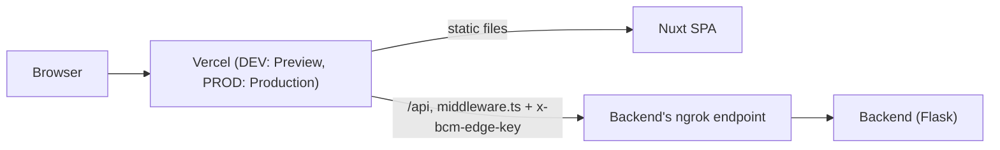

# BCM Tools — Frontend

Nuxt 4 single-page app for BCM Tools, built with Nuxt UI. In production it is served by nginx, which also forwards `/api/*` to the backend, so the browser only ever talks to one origin.

The backend (Flask API, ID-and-password sign-in, roles and menus, SMTP email, MySQL) lives in a separate repository (`bcm-backend`).

---

## Contents

- [Tech stack](#tech-stack)
- [How it fits together](#how-it-fits-together)
- [Project structure](#project-structure)
- [Getting started](#getting-started)
- [Scripts](#scripts)
- [Configuration](#configuration)
- [Authentication in the frontend](#authentication-in-the-frontend)
- [Building pages](#building-pages)
- [SCCA](#scca)
- [RA](#ra)
- [Location](#location)
- [Task Management](#task-management)
- [Testing](#testing)
- [Docker images and nginx](#docker-images-and-nginx)
- [CI/CD](#cicd)
- [Compatibility with the backend](#compatibility-with-the-backend)
- [Troubleshooting](#troubleshooting)

---

## Tech stack

| Concern | Choice |
|---|---|
| Framework | Nuxt 4 (Vue 3, TypeScript), client-side rendering only (`ssr: false`) |
| UI | Nuxt UI 4 (Tailwind CSS 4), themed by the [design system](docs/design-system.md) |
| Font | Inter, self-hosted via `@fontsource-variable/inter` (no Google Fonts) |
| Icons | Lucide, bundled locally via `@iconify-json/lucide` (no runtime calls to the Iconify API) |
| State | `useState` composables (add Pinia when state grows) |
| Tests | Playwright |
| Production server | nginx (`nginxinc/nginx-unprivileged`, non-root, port 8080) |

## How it fits together



DEV and PROD are two Vercel environments of one project, each pointing at its own backend:

| | DEV | PROD |
|---|---|---|
| Branch | `DEV-BCMTOOLS` (work on `DEV/<name>`) | `PROD-BCMTOOLS` |
| Vercel environment | Preview, on the fixed DEV domain (`DEV_DOMAIN`) | Production |
| `BACKEND_URL` | `https://` + the DEV ngrok domain | `https://divisive-eleonore-pseudosacrilegiously.ngrok-free.dev` |
| `BACKEND_EDGE_KEY` (Sensitive) | DEV key (same as the DEV backend's `policy.yaml` / `.env`) | PROD key (same as `backend-prod/policy.yaml`) |
| Deployed by | `deploy-dev.yml` | `deploy-prod.yml` (approver, release window) |

After changing a Vercel environment variable, redeploy that environment: Vercel reads variables when a deployment is built. The backend side (projects, ports, ngrok accounts) is in the backend README > *Environments: DEV and PROD*.

The same static build also runs behind the nginx image (`Dockerfile` target `prod`) when the frontend is hosted next to the backend instead of on Vercel.

- The app is pre-built into static files (`nuxt generate`). There is no Node server in production.
- All data comes from the backend over `/api/*`. The frontend never holds tokens or passwords after sign-in; it relies on the backend's `HttpOnly` session cookie and sends the session's CSRF token on every write.
- Sign-in is a form on `/login` that posts the ID (email) and password to `POST /api/auth/login`.
- **The menu comes from the database.** `GET /api/me/menu` returns the items the user's roles allow; the sidebar and the home page render it.
- Locally, the Nuxt dev server does the same proxying that nginx does in production.

## Project structure

```text
frontend/
├── app/
│   ├── app.vue                    # Root: <UApp><NuxtLayout><NuxtPage /></NuxtLayout></UApp>
│   ├── app.config.ts              # Nuxt UI theme: colour aliases, compact tables
│   ├── error.vue                  # Full-page error screen (404, unhandled errors)
│   ├── assets/css/main.css        # Design tokens: CIMB palette, chart palette, Inter, motion
│   ├── components/
│   │   ├── AppChart.vue           # Chart card: title, summary, "View as table", loading/empty, fixed height (ECharts)
│   │   ├── AppLogo.vue            # CIMB Niaga logo + "BCM Tools", top of the sidebar
│   │   ├── AppPage.vue            # Page frame: navbar (title, icon, actions, bell, user menu); breadcrumbs; <main>
│   │   ├── AuthShell.vue          # Brand panel + card for sign-in, forgot, reset and set-password pages
│   │   ├── ChangePasswordForm.vue, PasswordRules.vue  # Password change form and live rule checklist
│   │   ├── NotificationsMenu.vue  # Navbar bell and panel (placeholder: "Coming soon", empty state)
│   │   ├── UserMenu.vue           # Navbar, top right: avatar, name, roles; Profile, Change password, Sign out
│   │   ├── UserPicker.vue         # Search /api/users and pick a user by id (`permission` filters, e.g. scca.access)
│   │   ├── admin/                 # AdminUserForm, AdminPasswordDialog, AdminMenuForm, MenuRowActions;
│   │   │                          # scca-config/: Versions, Lists, Questions, Steps, Formula, Notes, Reminders, Changes
│   │   │                          # ra-config/: Versions, Hazards, Guides, Roles, Texts, Divisions, Reminders, Changes
│   │   ├── StatusBadge.vue        # Renders a value from a status scale (label, colour, icon)
│   │   ├── TablePagination.vue    # Table footer: "Showing x–y of z" + pager (URL `to` or v-model:page)
│   │   ├── ProfileFields.vue      # Label/value list used on the profile page
│   │   └── scca/                  # SccaRecord, SccaReport, SccaResolve; one Scca*Form.vue per tab, SccaMatrix, SccaReportDownloads,
│   │                              # charts (SccaBarChart, SccaLineChart), BCM board dialogs
│   ├── charts/echarts.ts          # ECharts parts + `bcm` theme; loaded on demand by AppChart
│   ├── composables/
│   │   ├── useAuth.ts             # Current user, menu, login(), logout(), changePassword(), can(), hasRole()
│   │   ├── useAdmin.ts            # Administration types, adminApi, status scales, labels
│   │   ├── useNotifications.ts    # Notification type and unread count; empty until the backend serves them (see the file)
│   │   ├── useProfile.ts          # GET /api/me/profile; photo at /api/me/photo (upload with PUT)
│   │   ├── useScca.ts             # SCCA types, list/detail/config fetchers, mutations, report URLs, 422 field errors
│   │   ├── useSccaConfigAdmin.ts  # Administration > SCCA configuration: versions, edits, publish, signers
│   │   └── useSccaWorkflow.ts     # SCCA monitoring, approval inbox/history/board, reminder rules
│   ├── layouts/default.vue        # App shell: collapsible sidebar built from GET /api/me/menu
│   ├── middleware/auth.global.ts  # Sign-in, forced password change, and each page's `permission`
│   ├── plugins/api.client.ts      # Adds X-CSRF-Token to writes; 401 → sign-in, password_change_required → /account/password
│   ├── pages/
│   │   ├── index.vue              # Home: greeting, roles, approvals waiting, modules from the menu
│   │   ├── profile.vue            # The user's record (Employee, Organization, Contact, Location, Direct supervisor, Account), roles, photo upload
│   │   ├── login.vue, forgot-password.vue, reset-password.vue  # Public pages (no layout)
│   │   ├── account/password.vue   # Change password (forced after a temporary password)
│   │   ├── forbidden.vue          # Shown when a page's permission is missing
│   │   ├── admin/                 # users, roles, menus, settings/email, scca-config, ra-config, audit (settings/scca opens its Reminders tab)
│   │   └── scca/                  # {monitoring,manage,approval}/index.vue, …/[id]/index.vue + report.vue, manage/new.vue; [id] resolvers
│   ├── types/page-meta.d.ts       # Adds `public` and `permission` to definePageMeta
│   └── utils/                     # Auto-imported: format.ts (English dates, id-ID numbers/Rp, WIB), limits.ts, chart.ts, status.ts,
│                                  # scca.ts (SCCA constants, gap checks, workbook notes), scca-config.ts
│                                  # (a version's lists, steps, notes; label registry), menu-icons.ts
├── docs/design-system.md          # Design system spec: tokens, components, accessibility, writing style
├── public/                        # Copied as-is: cimb-niaga-logo.svg, favicon.ico
├── e2e/
│   ├── ui/                        # Playwright tests with the API mocked
│   └── smoke/                     # Playwright tests against a real backend
├── nginx/default.conf.template    # Production nginx config (BACKEND_URL injected at start)
├── .github/workflows/             # ci.yml, deploy-dev.yml, deploy-prod.yml, vercel-deploy.yml, rollback.yml, codeql.yml
├── compose.yaml                   # Local dev server with hot reload
├── Dockerfile                     # Targets: dev, build, prod
├── eslint.config.mjs              # ESLint (rules and code style set in nuxt.config.ts)
├── nuxt.config.ts
├── playwright.config.ts
├── .editorconfig, .nvmrc          # Editor settings; Node version used by CI
├── .env.example.dev               # Local development variables (copy to .env)
├── .env.example.production        # Deployed nginx image variables
└── package.json
```

### Naming conventions

| What | Convention | Example |
|---|---|---|
| Components | `PascalCase.vue`; a feature folder's components start with the feature name, so Nuxt's auto-import name is the file name | `components/scca/SccaRatingForm.vue` → `<SccaRatingForm>` |
| Tab or edit forms | `<Feature><Thing>Form.vue` | `SccaInterdependencyForm.vue` |
| Shared, feature-free components | at the root of `components/` | `UserPicker.vue`, `StatusBadge.vue` |
| Composables | `use<Feature>.ts`, one per feature | `useScca.ts` |
| Utils | lower-case feature or concern name | `utils/scca.ts`, `utils/format.ts` |
| Pages and routes | lower-case, nested by feature; `[id]` for a record | `pages/scca/monitoring/[id]/report.vue` → `/scca/monitoring/1/report` |
| Constants | `SCREAMING_SNAKE_CASE`, prefixed with the feature | `SCCA_DEPLOYMENT_MODELS` |
| UI tests | `e2e/ui/<feature>[-<area>].spec.ts`; mocks in `e2e/fixtures/<feature>.ts` | `e2e/ui/scca.spec.ts`, `e2e/ui/scca-approval.spec.ts` |

Values sent to the API (deployment model, business hours, recovery hours, ...) are the same lists as the backend's `app/models/scca.py`; keep both in step. All text files use LF line endings (`.gitattributes`).

Pages use `layouts/default.vue` and wrap their content in `<AppPage title="...">`, unless they opt out with `definePageMeta({ layout: false })`, as `login.vue` does.

**Before building UI, read [`docs/design-system.md`](docs/design-system.md).** It defines colours, typography, spacing, and how to use buttons, forms, tables, feedback, status badges, KPI tiles, charts and navigation.

## Getting started

### Prerequisites

- Docker Desktop, **or** Node.js 24.11+ (`.nvmrc`; 22.21+ also works) with npm 11.5+. Docker and CI use Node 24; use npm 11 locally too, because npm 10's `npm ci` rejects lockfiles written by npm 11.
- The backend running locally on port 8000 (see the backend README)

> npm 11.4 has a bug that crashes `npm install` on this project (`Cannot read properties of null (reading 'edgesOut')`). Upgrade with `npm install -g npm@latest`, or run `npx npm@latest install`.

### Option A: Docker (recommended)

1. Start the backend stack (in the backend repository): `docker compose up`
2. Start the frontend:

   ```powershell
   docker compose up --build
   ```

3. Open <http://localhost:3000>. You'll be redirected to the login page. Sign in with the first Administrator: the backend log prints its temporary password the first time it starts (`BOOTSTRAP_ADMIN_EMAIL`); you set your own password right after.

Source is bind-mounted, so edits hot-reload. The container runs `npm install` each time it starts, so after a pull or a new package `docker compose up` is enough; no rebuild is needed. File watching uses polling (`CHOKIDAR_USEPOLLING=true`) because Docker Desktop on Windows doesn't forward file-change events from the host.

The container reaches the backend at `http://host.docker.internal:8000`, so the backend can run in Docker or directly on your machine. If the backend is published on another host port (`BACKEND_HOST_PORT` in the backend's `.env`), add the same `BACKEND_HOST_PORT=8001` line to this repo's `.env` and run `docker compose up -d` again.

### Run against a remote backend (ngrok)

When the backend runs on another machine and is published with ngrok (backend README > Expose the backend with ngrok), point the dev proxy at its URL; the browser still talks only to `http://localhost:3000`, so sign-in, cookies and sealed passwords work unchanged.

```dotenv
# frontend/.env, Docker (docker compose up -d)
BACKEND_URL=https://<name>.ngrok-free.app
```

```powershell
# Node on your machine
$env:NUXT_DEV_BACKEND_URL = "https://<name>.ngrok-free.app"; npm run dev
```

The proxy sends `ngrok-skip-browser-warning`, so ngrok's free-plan warning page never replaces an API response. The production nginx image does the same when its `BACKEND_URL` is an ngrok URL.

#### Deployed on Vercel

On Vercel there is no nginx: `middleware.ts` (Vercel Routing Middleware, matcher `/api/:path*`) forwards every `/api` request to the backend, with `ngrok-skip-browser-warning` so the ngrok warning page never replaces an API answer, the profile photo or a download. The browser keeps calling the Vercel origin, so cookies, CSRF and sealed passwords work as behind nginx.

1. Vercel > Project > Settings > Environment Variables: `BACKEND_URL` = `https://<name>.ngrok-free.dev` (Production and Preview). Scheme and host only. For the DEV and PROD servers also `BACKEND_EDGE_KEY` (the server's key, sent as `x-bcm-edge-key`; [docs/ci-cd.md](docs/ci-cd.md)).
2. Redeploy (or push a commit). Without `BACKEND_URL`, `/api` answers 404. DEV-BCMTOOLS and PROD-BCMTOOLS deploy only through GitHub Actions (`vercel.json`).
3. In the backend's `.env`, set `PUBLIC_BASE_URL=https://<project>.vercel.app` so email links open the Vercel site, then `docker compose up -d`.

Check it: `https://<project>.vercel.app/api/health` returns `{"status":"ok"}`.

### Option B: Node on your machine

```powershell
npm install
npm run dev
```

The dev server runs on <http://localhost:3000> and proxies `/api` to `http://localhost:8000`. Point it elsewhere with `NUXT_DEV_BACKEND_URL`:

```powershell
$env:NUXT_DEV_BACKEND_URL = "http://localhost:8001"; npm run dev
```

#### Opening it from another device on the same Wi-Fi

`npm run dev` listens on every network interface, so a phone or another laptop on the same Wi-Fi can open the app. Use `npm run dev:local` instead to keep it on this computer only (for example on public Wi-Fi).

1. Find this computer's address: run `ipconfig` and copy the **IPv4 Address** under "Wireless LAN adapter Wi-Fi" (for example `192.168.1.23`). Nuxt also prints it as the **Network:** URL when it starts.
2. On the other device open `http://<that address>:3000`, with `http` and `:3000`.
3. If it doesn't load there, allow port 3000 through Windows Firewall once, in PowerShell as administrator (use your Wi-Fi's name from `ipconfig` if it isn't "Wi-Fi"):

   ```powershell
   Set-NetConnectionProfile -InterfaceAlias "Wi-Fi" -NetworkCategory Private
   New-NetFirewallRule -DisplayName "BCM Tools dev 3000" -Direction Inbound -Protocol TCP -LocalPort 3000 -Action Allow -Profile Private
   ```

Only port 3000 needs to be reachable: the dev server forwards `/api` to the backend on this computer. Sign-in works over plain `http` as long as the backend's `APP_ENV` is a development value; a deployed value makes the session cookie https-only. Office and guest Wi-Fi often block devices from reaching each other; if it works on a phone hotspot but not on the office Wi-Fi, that's the reason.

## Scripts

| Command | What it does |
|---|---|
| `npm run dev` | Dev server with hot reload on port 3000, reachable from other devices on the same network |
| `npm run dev:local` | Same, but only reachable from this computer |
| `npm run build` | Static production build into `.output/public` (`nuxt generate`) |
| `npm run preview` | Preview the production build |
| `npm run lint` | ESLint, including code style (`npm run lint:fix` to auto-fix) |
| `npm run typecheck` | Type-check the app (`vue-tsc`) |
| `npm run test:e2e` | Playwright UI tests (API mocked) against `E2E_BASE_URL` |
| `npm run test:smoke` | Playwright smoke tests against a real backend at `E2E_BASE_URL` |

## Configuration

The built app has no environment-specific settings: the same image runs in every environment because all API calls are relative (`/api/...`). Environment differences live in nginx and the backend. Templates: `.env.example.dev` (local development, copy to `.env`) and `.env.example.production` (the deployed nginx image).

| Variable | Where | Default | Purpose |
|---|---|---|---|
| `BACKEND_URL` | Vercel (Preview / Production), or the nginx container | — (required) | Where `/api` goes: the environment's ngrok domain on Vercel, e.g. `https://divisive-eleonore-pseudosacrilegiously.ngrok-free.dev`; the backend's address for nginx. Scheme and host only, no path. |
| `BACKEND_EDGE_KEY` | Vercel (Preview / Production) | — | Sent by `middleware.ts` as `x-bcm-edge-key`; the backend's ngrok policy refuses `/api` calls without it. Mark it Sensitive. |
| `APP_VERSION` | Docker build arg | `dev` | Written to `/version.json`; the deploy pipeline uses it to detect the new release. |
| `NUXT_DEV_BACKEND_URL` | Dev server | `http://localhost:8000` | Backend for the dev proxy. |
| `CHOKIDAR_USEPOLLING` | Dev server | unset | `true` to poll for file changes (needed for Docker on Windows). |
| `E2E_BASE_URL` | Playwright | `http://localhost:3000` | Site under test. |
| `BACKEND_URL` | `compose.yaml` (dev) | — | A backend elsewhere, e.g. `https://<name>.ngrok-free.app`; overrides `BACKEND_HOST_PORT`. In the production image it is where nginx forwards `/api`. |
| `BACKEND_HOST_PORT` | `compose.yaml` | `8000` | The backend's host port; the dev container proxies to `http://host.docker.internal:<port>`. Same value as in the backend's `.env`. |

## Authentication in the frontend

The backend owns authentication and access. The frontend signs in with a form, keeps the user and their permissions, and hides what the user can't use.

### `useAuth()`

```ts
const { user, menu, login, logout, changePassword, can, hasRole } = useAuth()

user.value                 // { id, username, name, email, roles: [{ code, name }], permissions, must_change_password, csrf_token } or null
await login(id, password)  // POST /api/auth/login
await logout()             // POST /api/auth/logout
can('scca.create')         // true if the user's roles grant any of the given permission codes
menu.value                 // GET /api/me/menu: the sidebar tree the user may see
```

### Pages, permissions and the route guard

`app/middleware/auth.global.ts` runs before every route:

1. No user loaded → `GET /api/me`; on 401 → `/login?redirect=<original path>`.
2. `must_change_password` → `/account/password` until a new password is set.
3. The page's `permission` is missing → `/forbidden`.

```vue
<script setup lang="ts">
definePageMeta({ permission: 'scca.create' })  // any of several: permission: ['a', 'b']
</script>
```

Public pages (sign-in, forgot and reset password) use `definePageMeta({ public: true, layout: false })`.

### Sign-in, password reset and CSRF

- `/login` posts the ID and password **sealed** (`utils/seal.ts`): `sealedFetch` gets the backend's public key and a one-time nonce from `GET /api/auth/seal-key`, encrypts the fields with AES-256-GCM and wraps the key with RSA-OAEP, so the request body carries no readable password or ID. Changing a password, the reset page, an administrator's temporary password and the SMTP password/API key are sealed the same way. Web Crypto needs HTTPS or `localhost`.
- On `/login`, a wrong ID or password, a locked account (5 failures, 15 minutes) and rate limits each show their own message.
- `/forgot-password` emails a reset link (30 minutes); `/reset-password?token=` sets the new password. Administrators' invitation emails use the same page (72 hours).
- `plugins/api.client.ts` wraps `window.fetch`, so every `$fetch`/`useFetch` write to `/api/*` carries `X-CSRF-Token` from the session, and a 401 sends the user back to sign in.

### Menus and role-based UI

The sidebar (`layouts/default.vue`) and the home page's modules come from `GET /api/me/menu`; administrators edit labels, icons, order, visibility and the needed permission in **Administration > Menus**. Icons must be in `utils/menu-icons.ts` (they are bundled at build time).

```vue
<UButton v-if="can('scca.create')" to="/scca/manage/new" label="New assessment" />
```

Hiding UI is for usability only. The backend enforces every permission with `@require_permission`.

### Administration

| Page | Permission | What it does |
|---|---|---|
| `/admin/users` | `admin.users.manage` | Users: create (invitation email or temporary password), edit, roles, deactivate, unlock, reset password |
| `/admin/roles` | `admin.roles.manage` | Roles and the permissions they grant |
| `/admin/menus` | `admin.menus.manage` | Sidebar items: rename, icon, order, hide, needed permission, add links |
| `/admin/settings/email` | `admin.settings.mail` | SMTP providers (Gmail, Resend or another server): add or edit them (passwords and API keys stored encrypted), test one, choose the active one |
| `/admin/audit` | `admin.audit.view` | Tabs: sign-in and admin events; **SCCA activity** (who created, edited, rated, submitted, approved, rejected, commented on or downloaded each SCCA, with what changed; search by ref. no., application or user; `?tab=scca&assessment=ID` shows one assessment, linked from its **Activity** button); **RA activity** (`?tab=ra`: every `ra.*` event — a building's details, emergency contacts, occupants, recovery team and call tree, its approval; RAs, their ratings and sign-off; disasters; approvals and reminders; RA configuration and the guidebook — with the building and RA or disaster ref., a group filter and a search; `?building=ID` shows one building with its RAs and disasters, linked from the building page's **Activity** button); email outbox with "Send again" |

## SCCA

System Criticality Categorisation Assessment, matching the workbook *SCCA Tools V4.2 for CIMB Niaga*. The pages call `/api/scca/*`. The SCCA menu has three sections, and **each has its own record page** (`components/scca/SccaRecord.vue` with a `section`; rules in `utils/scca-sections.ts`):

| Page | Permission | What it does |
|---|---|---|
| `/scca/monitoring` | `scca.access` | Every SCCA with `scca.monitor` (BCM, management); otherwise the SCCAs you assess, contribute to or sign. Filter bar kept in the URL (period, category, application state, department, search). Tabs: **Overview** (KPI cards (`KpiCard.vue`) that open the view they count, applications by final category, SCCAs finalised per month: `SccaBarChart.vue`, `SccaLineChart.vue` in `AppChart` cards, each with a summary sentence and *View as table*), **Renewals** (three KPI cards: overdue, due in 30 days, due in 31–90 days; a card filters the list to its bucket, `?bucket=`; and whether a renewal is started), **Register** (one row per application with its SCCA history), **Bottlenecks** (steps waiting longest, average working days per step, counted to the second on weekdays). Each tab has **Export to Excel** (`/api/scca/monitoring/<view>.xlsx` with the same filters) |
| `/scca/manage` | `scca.access` | **Drafts only** that I assess or contribute to (`mine=1&status=draft`, rejected ones included): my role, category so far, next step. **New assessment** (`/scca/manage/new`, `scca.create`) |
| `/admin/applications` | `scca.application.view` (edit: `scca.application.manage`) | The application master: search, status and category filters; add, edit, deactivate, delete what nothing refers to (`ApplicationForm.vue`, `composables/useApplications.ts`) |
| `/scca/approval` | `scca.access` | **My inbox** (steps waiting for me, working days waiting, reminders, escalation; *Coming up*, always shown: SCCAs that will reach me), **My history** (my decisions and approvals made on my behalf; search, decision, step, category, reason, dates), **BCM board** (`scca.approval.manage`: every pending step; search, step, waiting time, category, reason, approver; *Act*: send a reminder now, reassign the step (`SccaReassignDialog.vue`), approve on behalf with a reason and evidence (`SccaOnBehalfDialog.vue`); not on SCCAs you assess or contribute to) |
| `/scca/manage/{id}` | editor of a draft | The editable SCCA. **Save** for the open tab is in the top bar next to View report ("Save application", "Save ratings", …), with an *Unsaved changes* badge; it submits that tab's form by id (`<button form="scca-form-<tab>">`, spinner via `sccaSavingKey`). **Submit for approval** is on Result and sign-off, under the missing-fields list and the gap check (`SccaGapSummary.vue`, `utils/scca-checks.ts`; the same gap check shows in Approval and Monitoring); each tab shows how many mandatory fields it still misses. The Application tab starts with the reason: Annual review and System change pick the application from the application master (`SccaApplicationSearch.vue`), New application types a new code. Upstream and downstream applications are picked the same way and filled from their latest final SCCA. New assessment has *Create assessment* in the top bar, like Save on a saved SCCA |
| `/scca/approval/{id}` | can act on it | In approval: read-only tabs, the decision panel (**Approve / Reject**) above them, review comments on each tab |
| `/scca/monitoring/{id}` | can view it | Read-only, with **Start renewal** on a final SCCA (the new draft opens in Manage). Comments are shown, never written. An approver viewing it here gets **Open in Approval** |
| `/scca/{id}` and `/scca/{id}/report` | | Resolvers (`SccaResolve.vue`) for emails, the audit log and old links: they open the reader's section. `/scca` → Manage, `/scca?view=waiting` → the Approval inbox, `/scca/new` → `/scca/manage/new` |
| `/admin/scca-config` | `scca.config.view` | **SCCA configuration** by version (`?version=`, default the draft, else the active one; `?tab=`). Tabs: **Versions** (status, SCCAs on each, name, notes, renewal period), **Lists** (the 13 choice lists: code, label, report text, rules, active, order), **Questions and guides**, **Sign-off steps** (order, required, signer mode, roles, Excel box, comments on every tab), **Formula** (weight sets, CIA mix, levels, matrix, recovery standards; calculator; impact on the active version's SCCAs), **Rating notes**, **Reminders and escalation** (`scca.settings.manage`; live rules, not versioned: reminder days, escalation day and extra addresses, renewal notice days, overdue repeat, sending window; `/admin/settings/scca` opens it), **Changes** (diff against the version it was copied from). On **Sign-off steps**, a default or fixed step has its signer picker under it and a **Comments on every tab** switch (both saved at once, for every version, also SCCAs already in approval). Only the draft is editable (`scca.config.manage`); **Request publish**, then someone else with `scca.config.publish` **publishes** it |
| `/admin/ra-config` | `ra.config.view` | **RA configuration**, like the SCCA one, per module (`?kind=branch`) and version (`?version=`, default the draft, else the active one; `?tab=`). Version codes are `V.04`, `V.05`, … numbered per kind; the draft's code, name and notes are edited on **Versions**. Tabs: **Versions**, **Hazards and guides** (hazard groups and the Type of hazard in each, rating guides 1–5 per scale, mitigation examples), **Sign-off steps** (like SCCA's, `?tab=steps`: add, remove and reorder steps; each has a label, a title, a code, Required or optional (the last is always required), who picks the signer — Chosen, Default or Fixed with the signer picked under the step (`UserPicker`, saved at once for every version of the kind, `raConfigApi.setSigner`), or the LIC / LICOM of the Details tab — the role codes that may sign, its box on the Excel report, and **Signs**: Always or *Building waiting for approval* (`condition`, `RA_STEP_CONDITIONS`; the default steps end with **Building approved by**, which signs only an RA whose building is new and waiting for approval)), **Statements and notes** (building type description, hazards introduction, sign-off statement and Risk Summary note, in English; empty = the default), **Divisions** (the division list with MTD and critical rating; live), **Reminders and escalation** (live rules, like SCCA's), **Team diagrams** (`?tab=diagrams`, live, per kind: the recovery team structure and location call tree charts, the HO workbook's LCP pictures until **Upload image** puts a PNG or JPEG of 5 MB or less in their place, and **Use the workbook picture** goes back; each card shows the preview, its size in pixels and who uploaded it; `raConfigApi.diagrams` / `uploadDiagram` / `resetDiagram`, `components/admin/ra-config/Diagrams.vue`), **Access scope** (`?tab=access`, live, for RA and RA Branch alike, like SCCA's: rules of organization levels or named users with a validity, own or picked directorates, head office buildings and/or branches, Annual review / Structural change, renewal statuses and whether they can generate; **Check a user** says what a person gets; `raAccessApi`, `components/admin/ra-config/Access.vue`, `AccessRuleForm.vue`), **Changes**. Only the draft is editable (`ra.config.manage`); **Request publish**, then someone else with `ra.config.publish` publishes it. Assessments keep their version (`useRaFormula(kind, assessment.formula_version)`). The nine tabs keep their full labels and scroll sideways when they don't fit |
| `/admin/sites-config` | `sites.config.view` | **Sites configuration** (`pages/admin/sites-config.vue`, `sitesConfigApi` in `composables/useSitesConfigAdmin.ts`, cards in `components/admin/sites-config/`): the live settings of the Sites menu, not versioned, apart from RA configuration since 18 Nov 2026. Tabs (`?tab=`, `SITES_CONFIG_TABS`): **Disaster or incident** (`hazard-types`, the default), **Earthquakes** (`earthquakes`, BMKG) and **Past disasters** (`past-disasters`: BNPB's DIBI, WHO's outbreak news, OpenAQ's air quality, BMKG's weather warnings, WAQI, then GDELT's disaster news, and NASA FIRMS's fire hotspots and GDACS's alerts below it). Changed with `sites.config.manage`, read-only without it. Old links to those tabs on `/admin/ra-config` open it |
| `/admin/ra-migration` | `ra.migrate` | **RA migration** (`pages/admin/ra-migration.vue`, `raMigrationApi` in `composables/useRaMigration.ts`), the same page as SCCA migration for the signed HO and Cabang workbooks. **1. Choose the workbooks** (mixed, up to 200, 10 MB each) and the manifest (**Empty manifest** downloads it). **2. Review** reads each workbook, three at a time, saving nothing, and shows its type, its result (Ready, Needs a fix, Skipped, Can't be read) and what it becomes (Approved RA or Draft), the building (its ID, or *New building*) with the reason, the dates, the hazards rated, and why or what to fix. A row opens to who signed (users or text) and the reader's notes. A later workbook of the same building and year is skipped, and a later one of a new building renews it. **Import as draft instead** and **Leave out** read again with that choice. **Dry run report** downloads the review as CSV. **Import N RAs** confirms (approved, drafts, new buildings), then sends the run in parts and lists the RAs made with links. **Runs** lists the runs, with **Finish this run** for an interrupted one and **Undo** for 7 days. A migrated RA's page says it was brought in from the signed workbook, with **Signed workbook** to download it |

An SCCA's section (`sccaSectionFor`): **Manage** while it is a draft you edit; **Approval** while it is in approval and you decide, may comment, or run the BCM board (and don't assess it); **Monitoring** otherwise. Opened in the wrong section, a record page moves to the right one and keeps `?tab=` (except an approver in Monitoring, who stays read-only). Each section stays highlighted in the sidebar on its record pages.

Monitoring, approval and settings types and fetchers are in `composables/useSccaWorkflow.ts`; working days are Monday to Friday. **Every list is server-paginated**, 20 rows a page by default (Coming up: 10). **Rows per page** in the table footer picks 10, 20, 50 or 100 (`page-sizes`): list pages keep it in the URL (`?per_page=50`, `useRowsPerPage`), lists inside a tab or dialog keep it locally (`ROWS_PER_PAGE`), and a new size starts again at page 1. The same applies to RA (Monitoring, Manage, Approval, the Hazards table), Buildings, Disasters, Task Management, Users and the Audit log tabs: search `q`, filters, `page` and `per_page` are sent to the API, which returns one page with `total` and `pages`. On list pages (Manage, Monitoring's Renewals, Register and Bottlenecks, Approval's My inbox, My history and BCM board) the page and filters are kept in the URL (`?page=2`, `?coming=2`, `?decision=`, `?step=`). The footer is `TablePagination.vue`: "Showing x–y of z", Rows per page (`v-model:per-page` with `page-sizes`) and the pager, also used by Users and the Audit log tabs.

The editor has five tabs, one per part of the workbook. Each tab is one form component in `components/scca/`:

| Tab | Workbook sheet | Component |
|---|---|---|
| Application | `SCC_Rating` header, `SCC_Result` application details | `SccaDetailsForm.vue` |
| Rating | `SCC_Rating` (18 questions, guides, justification) | `SccaRatingForm.vue` |

- *Application details*: Application owner is read-only (the assessor, "Sub Directorate - name"); **Contributor (IT support)**, Country and Vendor are required. *Rating*: every rating and its justification are required (counts "18 of 18 rated · 18 of 18 justified"); the chooser lists all five levels (Critical, High, Medium, Low, Insignificant) and disables, with a tooltip, those the question has no guide for. *Criticality matrix*: cells filled with their category colour; the SCCA's cell is outlined red (no "This system" label). A signer who may comment on Result only sees a line saying so on the other tabs (`SccaTabComments.vue`).
| Interdependencies | `A3 Interdependency` | `SccaInterdependencyForm.vue` |
| Recovery | `SCC_Result` recovery blocks | `SccaRecoveryForm.vue` |
| Result and sign-off | `SCC_Result` scores, upgrade/downgrade, 8 sign-offs | `SccaResultForm.vue` |

**Configuration by version.** Every chooser, the questions and guides, the sign-off steps, the rating notes, the renewal period and the formula come from the SCCA's own configuration version (`GET /api/scca/config?version=`). `SccaRecord.vue` loads it with `useSccaConfig(assessment.formula_version)` and provides it (`sccaConfigKey`); the tab forms read it with `useSccaConfigContext()` and build their selects with `sccaListOptions()` (active items, plus a retired value the SCCA already stores, marked "(retired)"). A new assessment uses the active version. The V4.2 constants in `utils/scca.ts` remain the fallback. A loaded configuration also fills a label registry (`utils/scca-config.ts`), so step titles and list labels on lists, the approval board and the audit log follow the configuration. A draft on an older version shows **Move to V4.x** (`POST .../move-version`); the toast lists what has to be redone.

**Scoring stays on the backend.** The Rating tab previews through `POST /api/scca/calculate` and shows C, I, A, CIA with its level (`5-CIA`), Potential Loss with its level (`4-PoLoss`) and the category, the same figures as the workbook. The workbook's notes on C1 (C5 and P4 follow a Critical C1), A3 (highest category among *Full* dependencies) and I4 (number of interfaces) appear as warnings under those questions; like the workbook, they don't block saving (`ratingNoteWarnings()` in `utils/scca.ts`).

**Access and approval.** The API sends `permissions` and `my_role` with every assessment and the pages follow them: outside Manage, or without `can_edit`, the forms are wrapped in a disabled `<fieldset>`, the **Save buttons are hidden**, and a banner says why.

- *New assessment*: **Application name** (`SccaApplicationSearch.vue`) searches the applications already assessed (`GET /api/scca/applications`, name or code) or takes a new name. Picking one copies the header of its last SCCA (code, description, owner, IT support, stakeholders, country, vendor, deployment, customer facing, business days and hours), sets the reason to *Annual review*, and warns when that application still has an SCCA in draft or in approval.
- *Application* tab: **Contributor** picker (`UserPicker.vue`, searches `/api/users` and stores the user id). Only the assessor can change it.
- *Result and sign-off* tab: one `UserPicker` per sign-off step of the SCCA's version (V4.2: 9, including **BCM Reviewer** after IT Support PIC); designation and sub-directorate come from the user's profile. An *Optional* step can stay empty (skipped, "Not required"); a *default* step is filled in from the signer picked on the Sign-off steps tab; a *fixed* step shows its signer, locked, and is applied at Submit (it is not sent on save). `SccaApprovalPanel.vue` has Submit for approval (Manage), Approve / Reject with a note for the current approver (Approval), and the history; `:actions="false"` in Monitoring. There is **no recall**: once submitted, only a rejection returns the SCCA to draft.
- `SccaTabComments.vue` sits on top of every tab: during approval the approvers can comment on Result and sign-off; the other tabs only the BCM reviewer, at the BCM reviewer step (`permissions.comment_tabs`). The assessor and contributor read the comments but can't add any; `readonly` (Monitoring) never shows the box.
- A step approved by BCM on someone's behalf shows "on behalf, by X" and a link to the evidence, on the record and in both reports. A renewal links to the SCCA it renews; a final SCCA links to its renewal.

**Reports.** **View report** on every record opens its report page (`SccaReport.vue`). Once the SCCA is **final**, the report page (only) shows **Download PDF** and **Download Excel** (`SccaReportDownloads.vue`). They link to `GET /api/scca/assessments/{id}/report.pdf` and `.xlsx`: the backend fills the official workbook (formulas, charts and tick boxes kept) and lays out the PDF like the workbook's print. The backend refuses (409) a report for an assessment that is not final.

## RA

Risk Assessment of a work location, matching the workbook *HO Risk Assessment Location – Version 2025 – r4* (the LRP scorecard). **RA Branch** (`/ra-branch`) is the same module for branches, from the workbook *Risk Assessment Location – Version 2025-2026 – Cabang rev4*. Pages call `/api/ra/*`, with `?kind=branch` on the formula and list calls for RA Branch. The places both modules assess (the building register, the map, disasters and the guidebook) are in their own menu group, [Location](#location):

| Page | Purpose |
|---|---|
| `/ra/monitoring` | **Monitoring**, per building, like SCCA's: **Overview** (cards that open the matching list, locations by residual level, RAs approved per month), **Renewals** (overdue, due in 30 and in 90 days; columns as SCCA's — building, building ID, the location's *Directorate*, *Sub directorate* (a branch's region) and *Group* (a branch's area), highest residual, *Latest final RA ref. no.* and *Latest final RA date*, renewal date, due, Assessor, LICOM, *Renewal status*, *Renewal RA ref. no.* and *Current renewal step* — and an **Act** menu: Open last final, Open renewal, Generate annual review; the checkboxes tick the rows the user may generate (`can_generate`) for **Generate annual review (n)**, which asks first and says *Created n, skipped m* with the reasons; `raApi.generateRenewals`), **List** (every building with its building ID, the location's *Directorate*, *Sub directorate* and *Group*, highest residual, *Latest final RA ref. no.* and *Latest final RA date*, renewal date, the RA being worked on — its status in **Status** and, apart, its step in **Current approval step** — Assessor and LICOM; **RAs** opens every RA of the building, the current one and the replaced ones marked, with its own Excel export, `RaHistoryDialog.vue`; a checkbox column ticks buildings, across pages, for **Export N selected to Excel**, which sends `ids=`; the List export has one row per RA of each building, with Excel dates), **Approval** (RAs in approval by working days waiting, columns as SCCA's: *Assess since*, *Assess days*, *Reminders sent*, *Escalated on*). The column names follow SCCA's (26 Nov 2026), with the building in place of the application, *RA* in place of *SCCA*, *Highest residual* in place of *Category* and *LICOM* in place of *Contributor*. RA has no owner organisation, so it has none of SCCA's *Directorate owner*, *Owner sub-directorate* and *Owner department* columns. Renewals and the List show the location's own Directorate, Sub directorate and Group instead. Every column of Renewals, the List and Approval sorts on the server, as SCCA's (`useTableSort`, `?sort=&dir=` in the URL, sent with the tab shown; dates and counts start with the biggest; switching tabs clears it). Search (name, ID, address), state, residual-level and reason filters, region for branches, and the location's **Directorate, Sub Directorate, Group / Area and Division** (`useRaMonitoringOrgValues`) are kept in the URL. Outside BCM (`ra.monitor` / `ra.manage`) it shows the RAs the user takes part in, and Renewals also what their access scope opens |
| `/ra/monitoring/{id}` | Any RA, read-only, with **Open in Manage** (a draft you can edit) or **Open in Approval** (your step) |
| `/ra/{manage,monitoring,approval}/{id}/report` | **View report** (on every RA page, as SCCA's): the printable report (`RaReport.vue`) — Details, every hazard with its hazard group (a column, and a **Hazard group** filter for the screen as on the Hazards tab; printing always shows every hazard), gross and residual ratings, mitigation and action plan (columns size to their content so no heading runs into the next: short headings stay on one line and the text columns wrap; on screen the table scrolls sideways like the list tables; printed it starts on a new page, ten hazards to a page with the headings repeated, rows tightened so ten short ones fit; a row too long for the page still flows on). The report **prints in landscape only**: its header carries `data-print-landscape`, which gives every printed page the `landscape` named page in `main.css`, the Risk Summary levels with every hazard's name (`RaRiskSummary` with `report`: no Risk Matrix, whose numbers the Hazards table shows), the sign-off statement and the signers. **Print** (primary) uses the browser; once approved, **Download** offers the PDF and the Excel workbook |
| `/ra/manage` | **Manage**, as SCCA's. The drafts you are the assessor (LIC) or LICOM of, including those returned for changes, and the generated annual reviews your access scope shows read-only (`mine=1`), server-paginated, with search, location, reason and period filters. Columns in SCCA's order: **Current RA ref. no.**, the building (the link) and its **ID**, **Status**, **Assessment reason**, **Period**, **Renews RA ref. no.** (the final RA an Annual review renews, a link only when you may open it), **My role** (Assessor, LICOM, or *Directorate (view)* with an eye badge), **Assessor**, **Rated**, **Highest residual**, **Renewal date**, **Next step** and **Last saved** (red when returned or overdue, amber when ready or due soon), with SCCA's column widths. Every column sorts on the server, as SCCA's (`?sort=&dir=`; Renewal date and Last saved start with the newest). **New assessment** sits in the top bar, as in SCCA |
| `/ra/manage/new` | New assessment for a location and period, with the location incident team (`RaTeamMember.vue`, both with a mobile number, all required; the numbers are phone numbers, never text, checked with `raPhoneProblem` in `utils/ra.ts` as the API does, and a profile mobile that isn't one, such as "-", is not filled in, `raPhoneOrEmpty`): the **LIC is always the assessor**, the signed-in user, shown read-only (`fixed`) with the mobile number from their profile, and never sent (the API sets it); the LICOM is picked from the BCM Tools users. Starting from the previous assessment of that location brings its LICOM (and the LIC's number when the LIC was you). On the Details tab the LIC is also read-only. Neither field says which step they sign. **New building** (13 Nov 2026), unless opened from a building's page (`?location_id=`): no building is picked; the new building is entered on the same page, below, in tabs (**Details**, **Map**, **Emergency contacts** and, for head office, **Occupants**, **Recovery team**, **Call tree**), the same forms as the building page in draft mode (`draft`: no Save button, the page reads them with `collect()`; the Occupants dialog keeps its rows on the page). **Create assessment** checks every tab, opens the first one that needs attention, and sends one request (`raApi.createWithBuilding`, `POST /api/ra/assessments/new-building`): the building, its profile and the RA are saved together, or nothing is. Errors on the building's fields (`location.<field>`) go back on its Details tab |
| `/ra/manage/{id}` | Tabbed editor for one RA cycle. As SCCA's, the open tab's **Save** is in the top bar next to View report (*Save assessment*, *Save ratings*, *Save signers*; none on Risk Summary), with an *Unsaved changes* badge, enabled once something changed; it submits that tab's form by id (`ra-form-<tab>`, `raSavingKey` for its spinner). An RA can't be deleted. Tabs: **Details** (dates, the required LIC and LICOM — picked from the users; picking one fills their mobile number from the directory unless one was typed — and, below, the RA's building with the building page's tabs, `RaBuildingSection.vue`: Details, Map, Emergency contacts and, for head office, Occupants, Recovery team, Call tree, each saved on its own, editable while the RA can be edited by who may edit buildings; its unsaved changes are its own, not the RA's top-bar Save), **Hazards** (a table of the 33 hazards, each opening its own page), **Risk Summary** (the CIM note, hazards by residual level with their existing mitigation measures, gross and residual tables), **Sign-off** (the approval workflow below; a changed signer must be saved before **Submit for approval**, which is disabled with *Save the signers before you submit.*) |
| `/ra/approval` | **Approval**: **My inbox** (RAs waiting for my sign-off, working days waiting) with **Coming up** (where I sign a later step), **My history** (what I submitted, approved or returned, approvals BCM gave on my behalf and signer changes; `?action=`) and, with `ra.manage`, the **BCM board** (every RA in sign-off, by step; *Act*, as SCCA's: open the sign-off, send a reminder now, change the signer of the waiting step with a reason (`RaChangeSignerModal.vue`), approve on behalf with a reason and evidence (`RaOnBehalfModal.vue`)). Columns as SCCA's: My inbox has the building, *RA ref. no.*, *Highest residual*, *My step*, *Submitted date*, *Submitted by*, *Status*, *Assess days*, *Reminders sent*; Coming up the building, *Current approval step*, *Approver*, *Assess days*; the BCM board the building, *RA ref. no.*, *Highest residual*, *Current approval step*, *Approver*, *Status*, *Assess since*, *Assess days*, *Reminders sent*, *Escalated on*; My history *Decided on*, the building, *Approval step*, *Decision*, *Status now*. As SCCA's, the tables have its column widths, name a step by its short name (*LIC*, *LICOM*; `step_short`, `role_short` and `current_step_short` from the API) and show no assessment reason under the building, and so does Monitoring. Every column sorts on the server (`?sort=&dir=`); Coming up keeps its own sorting (`?coming_sort=&coming_dir=`, `useTableSort(…, { prefix, page })`) |
| `/ra/approval/{id}` | The RA opened on its **Sign-off** tab, to approve or return it |
**Access.** RA (head office) and RA Branch are granted separately: `ra.access` / `ra.edit` / `ra.manage` for RA, `ra_branch.access` / `ra_branch.edit` / `ra_branch.manage` for RA Branch. Each module's permissions are in `RA_MODULES[kind].perm`, so components check `can(ra.perm.edit)` rather than a literal code, and `useRaKinds(level)` lists the sides the user holds. `/ra/*` pages need `ra.access` (*New*: `ra.edit`), `/ra-branch/*` pages `ra_branch.access` (*New*: `ra_branch.edit`); the Sites pages take their own permission or either side's access (`['sites.access', 'ra.access', 'ra_branch.access']`), and the Sites menu shows with `sites.access` only. With it, a building page opens for every building and branch (`useLocationKinds`); RA references the user can't open show as plain text, not links (`useCanOpenRa(kind, record)`). That is no access to the side, or, as SCCA's, an RA that isn't theirs. The API sends `can_open` on every RA reference (true for BCM of the side, its assessor, LICOM and signers, and the directorate view of a generated annual review), and Monitoring, Manage's Renews, building pages, the map and a crisis's affected places follow it. Only the assessor and the LICOM edit a draft (`can_edit`). **Generate annual review** (`RaGenerateDialog`, as SCCA's) asks for the LICOM of the new drafts, a user of the access rules' LICOM levels (`contributor_levels`) from `/api/ra/monitoring/renewals/contributors`, suggesting the last final's LICOM. RA configuration › Access scope rules also have **Highest residual** (`risk_levels`) and **LICOM levels**, and Check a user says whether the user may be a generated LICOM. Someone holding one side sees no Type filter in Buildings and adds only that type. Without edit rights the lists hide **New assessment** / **Input building data**, and a building page shows its tabs read-only (each tab's content sits in a disabled `<fieldset>`, and the API refuses changes anyway). Declaring a disaster needs `sites.disaster.declare`, an incident `sites.incident.declare` (the map offers only the types allowed, `declare_types`; the users who work on RAs hold both), and updating, closing and reopening one `sites.disaster.update` / `sites.incident.update` (`can_manage`); the API says what the user may do (`can_declare`, `can_manage`, `can_delete`, `can_edit`). Signers, the LIC and the LICOM are picked from users holding the RA's side (`/api/users?permission=ra.access` or `ra_branch.access`); users with only RA or RA Branch (no SCCA) can search them too.

**Reason for assessment** (`RA_REASONS` in `utils/ra.ts`, like SCCA's): Annual review, New building, Structural change (After a disaster was dropped). It is the first field of New assessment and of the Details tab, laid out like SCCA's Application details: the reason on its own row (the select half width, its help across the whole row, changing with the reason picked: `raReasonHelp`), then the building, then Assessment date and Renewal due date side by side. Until a reason is chosen every other field (and the Location incident team) is disabled, in a `<fieldset>`, as in SCCA. **SCCA's conditions** (`SccaDetailsForm.vue`) apply on New assessment: the reason decides which buildings the picker lists, as SCCA's reason decides how the application is chosen — New building only buildings without an RA, Annual review and Structural change only those with a final RA (`final_assessment` on each building) — with a help line saying so. **SCCA's reason rule** comes from the API (`raApi.locationScope(kind, reason)` → `problems`): a building with another RA open, or overdue for a Structural change, is listed greyed out with the reason, as SCCA's application lookup does; a building opened from its page that the rule refuses shows the reason in the note instead ("Annual review isn't possible for this building"). The Details tab asks the same (`assessment_id` so the RA's own draft doesn't count) and offers such a reason disabled, saying why. Changing the reason to one the picked building doesn't fit asks *Change the reason?* (why, and that the building is cleared); Cancel keeps both. Picking a building shows a note instead of the old *Start from* checkbox, as SCCA does for a picked application: *No RA yet for this building*, *This building already has an RA draft / in approval* (warning: check with its LIC) or *Existing building* ("Copied the assessment details from its last RA (RA-2026-0006, 23 Oct 2026). Approvals start over. …"), and the new RA always starts from the building's last RA (team, ratings, signers). A building that already has an RA for the year of the assessment date is flagged on the date before saving, except a Structural change, which may follow in the same period once that period's RA is final (until then it says the RA isn't final yet). The error banner lists each field's message, like SCCA's (`raErrorText`). On the Details tab the building is fixed, so a reason it doesn't fit is offered disabled, saying why. There is no RA period field: the period is the year of the assessment date (`raPeriodOf`; on the Details tab it follows the date only when the date is changed). The reason is required, preselected as Annual review when the building has a final RA and New building when it has no RA (the API checks both); the Details tab changes it while the RA is a draft. **Structural change works like SCCA's System change** (`RA_CUSTOM_DUE_REASON`): it shows a required *Renewal due date* picker limited to the assessment date … one year later; every other reason shows "Renewal due …, one year after this assessment" and sends no date. Manage has a Reason column and filter, Monitoring a reason filter and the reason under the last final RA, Approval the reason after the RA code.

**Names and statuses.** RA (head office) is **RA HO** everywhere — the menu group (from the API), page titles, breadcrumbs, Home's overview — beside **RA Branch** (`RA_MODULES[kind].title`). An RA's status reads as in SCCA: **Draft**, **In approval** (orange), **Final** (`raStatus`, the same words and colours as `sccaStatus`); a returned RA is a draft again, its page saying who returned it and why. Status columns are centred (`RA_STATUS_COLUMN`). The API's period error ("This location already has an assessment for 2026.") shows on the assessment date (`raHeaderErrors`), since there is no period field.

**Filter bars.** Every RA list uses SCCA's `ListFilterBar` in SCCA's order: the search box first (building, ID, ref. no.), then status or step → category-like filters (level, type) → reason → person → place (region, province) → dates, then *Clear filters*. Manage: search, building, reason, whose drafts, period. Monitoring: search, state, highest residual level, reason, region (branches), assessment date. Approval > My history: search, action; BCM board: search, step, with the reminder rules under the bar. Buildings: search, status, type, province. Incidents: search, status.

**Home.** The **Overview** has one tab per module the user's roles open (`pages/index.vue`, `GET /api/tasks/summary`, `useTaskSummary`): SCCA, RA HO, RA Branch, BIA and, for disaster and incident approvers, Sites; a tab's badge counts what waits for the user. Every tab shows the same two cards for everyone, *Waiting for me* (`view=mine`) and *In approval* (`view=approval`). For the module's BCM (`oversees`) the **Overview Administrator** above them adds the admin tasks: *Stuck sign-offs* (`level=stuck`; in Sites *Escalated approvals*), *Overdue renewals* (`type=renewal&level=overdue`, with how many more are due within 90 days; not in Sites) and, in RA HO and RA Branch for who opens Master building, *Buildings waiting* (`type=building`). The cards come from `taskCards` (`composables/useTasks.ts`), the same as in Task Management, and each opens that module's tab there, filtered to it. A count not read yet shows 0, here and in Task Management.

**Downloads.** As SCCA's, they are on the report page only (**View report**): once an RA is **approved**, it has a **Download** menu in the top bar beside **Print**: the **PDF report** and the **Excel workbook** — the official HO or Cabang RA workbook filled in (`GET /api/ra/assessments/{id}/report.pdf|xlsx`, `downloadRaReport()` in `useRa.ts`). Before approval there is no menu, and the API refuses the download (409), as SCCA does until an assessment is final.

**Tab counts.** In Manage, while the RA is a draft you can edit, each tab shows in a red badge how much is still needed before Submit, as SCCA's (`raMissing` in `utils/ra-checks.ts`, the same rules as the API's submit check): Details — reason, assessment date, renewal due date for a structural change, LIC and LICOM with their mobile numbers; Hazards — the hazards not rated or with open issues; Sign-off — the required steps without a signer (a fixed step gets its signer at Submit). The counts follow the saved RA. Monitoring and Approval show none.

**Sections.** As in SCCA, an RA is opened from one of three sections (`RA_SECTIONS`, `raPath(kind, section, id)` in `utils/ra.ts`): `RaAssessmentPage.vue` takes `section` — Manage edits, Monitoring is read-only on top of what the API allows (`can_edit`, `can_approve`… are cleared), Approval opens on the Sign-off tab. Links to an RA from elsewhere (locations, the map, disasters) use `raRecordPath()`: a draft opens in Manage, anything else in Monitoring. Links to a location use `locationPath(id, tab?)`. Old links keep working: `/ra` → Monitoring, `/ra/new` → `/ra/manage/new`, and `/ra/{id}` (`RaResolve.vue`) picks Manage for a draft you can edit, Approval for your step, otherwise Monitoring. The page components are `RaMonitoringPage.vue`, `RaManagePage.vue` and `RaApprovalPage.vue` (`useRaOverview`, `useRaRenewals`, `useRaRegister`, `useRaBottlenecks`, `useRaInbox`, `useRaUpcoming`, `useRaHistory`, `useRaBoard` in `useRa.ts`); renewal buckets use `raRenewalBucket`.

The Hazards tab starts with the introduction from the RA configuration (`formula.hazard_intro`) and a **table** of every Type of hazard (`RaHazardForm.vue`): hazard group, type of hazard, historical and probability of occurrence, the probability rating (filled in), the four impacts, the impact rating (filled in), the existing mitigation and the residual level, with a group filter. Its pencil opens the hazard's **page** (`?tab=hazards&hazard=H03`): **Hazard group name** and **Type of hazard** dropdowns to move between hazards, Probability (1. historical, 2. probability → probability rating), Gross impact (four impacts → impact rating; RA Branch: the impact after mitigation), Existing mitigation measures, then, as the HO workbook continues, the probability and impacts after mitigation, the residual risk and the action plan (no CIM ref. no.). **Previous hazard** and **Next hazard** slide back to the top of the page and open the next one there (at once with reduced motion). Edits are kept while moving between hazards and the table; **Save** sends only the hazards that changed. **How to fill in the questionnaire** opens the workbook's Lampiran tables (`RaGuideModal.vue`). Ratings are `N/A` or 1–5 with the workbook's guidance (in English) under each field. Existing mitigation measures and the action plan take up to 3,000 characters with a counter (`TEXT_LIMITS.hazard`). Levels update while you type through `raRateHazard()` in `utils/ra.ts`, a mirror of the backend calculator. Issues show on the hazard and keep the assessment a draft, but never block saving.

**Past disasters (BNPB's DIBI).** Under a hazard's Probability, `RaPastDisasterHint` shows how often BNPB recorded that hazard in the building's regency over its review years (`GET /api/ra/locations/{id}/past-disasters`, `useRaPastDisasters`), e.g. *BNPB recorded it 12 times in Kota Adm. Jakarta Selatan from 2017 to 2026.*, with the disaster types, the last date and BNPB as the source. It says when no DIBI regency matches the building's city or when none was recorded, and shows nothing until DIBI has been read. **Sites configuration › Past disasters** (`AdminSitesConfigPastDisasters`, `/admin/sites-config?tab=past-disasters`) switches the backend's scheduled read on or off, sets every how many days and how many years, shows the last read, its error and the records kept, maps each DIBI category to an RA hazard or none, and has **Read at the next run**.

**BMKG weather warnings (H06).** On the weather hazard (Sites configuration's choice, H06 *Cuaca ekstrem* by default) the hint says how often BMKG warned of severe weather over the building and on how many days in the review years, with the latest five warnings and since when warnings are kept. `AdminSitesConfigWeather` (Sites configuration › Past disasters) switches the read on or off, picks the hazard, shows the last read, how many are active, kept and over a place, and has **Read at the next poll**. **WHO outbreak news and OpenAQ air quality (H11 and H10).** The same hint shows WHO's outbreaks in the country for H11 (with the latest five items linked to who.int) and, for H10, the days PM2.5 was above the threshold at the station nearest to the building (with the days measured and the worst day). A building without coordinates is told OpenAQ can't find a station. When one of them speaks for a hazard, DIBI's "recorded none" line is left out. **Review years.** Under Probability, *Review past occurrences from* and *to* (`USelectMenu`, 2000 to this year, clearable) pick the years each hazard is reviewed over, saved with its rating (`review_from_year`, `review_to_year`). The hint counts DIBI, WHO and OpenAQ over them (`useRaPastDisasters(id, years)`, `?from=&to=`), and over the last 10 years while they are empty (shown as the placeholders). It also says when DIBI's records or the station's days start later than the from year. The hint gives counts only, with no suggested rating and no Use button. An Annual review starts with every hazard unrated (the New page says so). Sites configuration › Past disasters has a card for each beside the DIBI form. `AdminSitesConfigOutbreakNews` switches WHO's daily read on or off, picks the hazard it counts for and has **Read WHO now**. `AdminSitesConfigAirQuality` switches OpenAQ on or off, picks the hazard, sets the daily PM2.5 threshold (55.4 µg/m³) and how often each building is read again, warns when the server has no OpenAQ API key, shows how many buildings are read and has **Read every building again**.

**GDELT's Indonesian news (each hazard with keywords).** The hint also says how many Indonesian news articles named the building's city with the hazard's keywords in the review years, on how many days, with the latest five linked, the keywords, since when the counts are kept and *Source: GDELT* (`data-testid="gdelt-news"`, the API's `gdelt.hazards[code]`). It shows only once GDELT has read that city and hazard, and then DIBI's "recorded none" line is left out. `AdminSitesConfigGdelt` (`components/admin/sites-config/Gdelt.vue`, full width under the other Past disasters cards, `sitesConfigApi.gdelt`) switches GDELT on or off, sets the radius around a news place (km) and every how many days each city is read again, and has a table of every hazard with its **Map themes (GDELT)** and **History keywords**, comma-separated, the API's messages on their field. A note under the table says the map shows a news place only when its article's headline names both the hazard (one of its keywords) and that place. It shows the map's last read and the news places shown with the title check (articles kept, left out because the hazard or the place was only in the body, waiting), how many city and hazard pairs are read and due and since when counts are kept, the last errors, and has **Use the defaults**, **Read again** and **Save GDELT settings**. The other source lines of the hint now say *Source:* too (*Source: BNPB DIBI*, *Source: OpenAQ*).

The **Risk Summary** tab (`RaRiskSummary.vue`) shows the CIM note in Indonesian and English with an info icon, then the Type of hazard counted by residual level (High, Medium, Low, NA): each level opens to its hazards with their group, gross risk and existing mitigation measures, and a hazard name opens it on the Hazards tab. Under it, the **Heat Map Matrix** as tables — gross and residual side by side (RA Branch: residual only), each shown or hidden — with the probability, impact and level of every rated hazard. Text is left-aligned and numbers right-aligned.

**Organization.** The building form has an **Organization** card on the right (stacked below when the form is narrow, a container query): Directorate, Sub Directorate, Group and Organization level (the user master's `directorate`, `sub_directorate`, `org_group`, `org_level`), picked from its values (`useRaOrgValues`; a new value can be typed). Division and Department are no longer asked (a saved value is kept). A new head office building starts with the signed-in user's Directorate, Sub Directorate and Group (`useProfile`). With the region directory, a branch's Directorate (from there), Sub Directorate (its region) and Group (its area) are shown read-only; while the directory is empty there is no Region field, and the branch's Sub Directorate and Group are picked here (its region and area follow them). Monitoring filters by them and the access scope opens a location to the users of its directorate. On New assessment, an Annual review or a Structural change offers only the buildings the access scope opens (`raApi.locationScope`), with the help saying so.

**Building profile.** Emergency contacts and the Location Continuity Plan (LCP) sheets describe the building, not one year's assessment, so they are edited on the building page and every assessment of that building uses them. Sections C (building occupants) and F (business continuity strategy) describe the same units, so they are one list with two views on the **Occupants** tab: *Building occupants* (floor, directorate, employees, disability, pregnant, shifts) and *Continuity strategy* (MTD, BCP, alternate site). Each row is a **division** picked from the division list in RA configuration (`useRaDivisions`): its MTD and critical rating follow the division and are shown read-only; a division that isn't listed is added from the dialog with its MTD and critical rating, set once. Shift work, BCP and alternate site are dropdowns. Divisions are added and edited in a dialog (`RaOccupantModal.vue`) and each change is saved straight away. The **Recovery team** and **Call tree** tabs use one grouped row editor (`RaGroupedRowsForm.vue`): a card per team or call-tree level, and in it, as in the workbook's merged cells, a **role** (recovery team) or **caller** (call tree) written once with its people under it: **Add role** / **Add caller** on the card, **Add member** / **Add contact** under a role or caller. Every field takes free text, so a note goes where a person would ("Sesuai Tab LRP (front)" for the floor wardens, "(Sesuai Shift)" for security, "Sesuai dokumen BCP masing-masing", "(Jika ada)", "(Sesuai struktur)"); the role, name and mobile (caller, contact and mobile) are required, as any text, so a mobile can be a note too; the home phone and the call tree's division are optional. Saved with one button: the API gets one row per person with the role or caller repeated, in order, and the workbook and PDF write it once. Rows left empty are dropped; a role or caller needs at least one person. Above the editor, **View structure chart** and **View call tree chart** (`RaDiagramButton.vue`, outside the read-only fieldset so viewers can open them too) show the chart of the location's kind in a dialog, fitted to the window, with **Open full size**: the picture of the HO workbook's LCP sheet, or the one BCM uploaded in RA configuration › Team diagrams (`raDiagramUrl(kind, diagram)`, `RA_DIAGRAMS` in `utils/ra.ts`). The Excel and PDF downloads print the same chart.

**Sign-off.** The Sign-off tab runs the approval workflow (`RaSignoffForm.vue`): while the assessment is a draft, each role gets a signer picked from the BCM Tools users (`RaSignerSelect.vue`); the designation is the signer's job title from the user directory, shown read-only (the backend sets it). The steps follow the assessment's configuration version (`formula.signoff_steps`, `raRoleOptions`): a step signed by the LIC or LICOM (by default Prepared by and Reviewed by) is shown locked, with a pointer to the Details tab; a fixed step is locked too and gets BCM's fixed signer at Submit; a default step starts with BCM's default signer and can be changed; an optional step can be left empty and is then skipped ("Not required"). Only chosen and default steps are sent from the Sign-off tab. **Submit for approval** needs every hazard rated without open issues and a signer on every required step. The statement shows in Indonesian and English, with the sign-off history right under it; the step titles and short names come from the assessment's configuration version (`raRoleOptions(formula, …)`; an option's `label` is the title, its `hint` the short name, and `raSignoffRoleName` / `raStepTitle` give the title, as SCCA shows a step; Monitoring's *Average working days per sign-off step* chart and its *Slowest step* line use the short name, `step_short`). The signers then approve one after another; the current signer sees **Approve** with an optional comment and **Return for changes**, which asks for a comment (`RaReturnModal.vue`) and sends the assessment back to draft. BCM (`ra.manage` / `ra_branch.manage`, `can_act_for_signer`), when neither the signer nor the RA's assessor, sees **Act for the signer** instead: **Return for changes**, **Change the signer** and **Approve on behalf** (the same dialogs as the BCM board). As in SCCA, the assessor — who made the RA, shown read-only under Assessment date on the Details tab and New assessment — cannot act for a signer of their own RA, in RA and RA Branch alike, BCM admin or not: on the BCM board the row reads "Your own RA: reminders only" (`can_act: false`) and only **Send a reminder now** stays enabled. Monitoring's List and Renewals tabs and their Excel exports show the **Assessor** instead of the LIC. A step approved on the signer's behalf shows "by X on their behalf" and a link to the evidence; the history shows signer changes ("Rina → Stand In") and approvals on behalf ("for Alan") with the evidence. While in sign-off or approved, the Details and Hazards tabs are read-only and a banner says who is up next. **Moving to the active version (as SCCA's):** in Manage, a draft on an older configuration version shows an info note, *This draft uses V.04. V.05 is the active version.*, with **Move to V.05** (`raApi.moveVersion`, after a confirm); the tabs then use that version's hazards and descriptions, guides, matrix, statements and sign-off steps, and a toast lists what to redo (`cleared`). An RA keeps its version otherwise, so a hazard description added in a newer version shows on the hazard page only once the draft moves. Statuses use `raStatus` through `raStatusKey`: Draft, **Need revision** (a signer returned it and its assessor hasn't accepted the return yet), **In revision** (accepted, being changed), In approval, Final; what waits for me is in **Approval**. **Accepting a revision:** a returned RA shows `RaRevisionBanner.vue` on every tab with the signer's comment. While it is Need revision every form is read-only (`can_edit` is false) and the assessor alone sees **Accept revision** (`raApi.acceptRevision`, `can_accept_revision`); everyone else reads *Waiting for … to accept the revision*. The assessor is emailed at the return and reminded each working day until they accept. After accepting, the banner says *In revision* and who accepted it, the forms open again, and the sign-off history shows *Accepted the revision*. Monitoring has a **Need revision** and an **In revision** card and State option (`state=need_revision` / `in_revision`; *Draft open* is a draft never returned), and the List and its export say the same words. **A New building's date, as SCCA's New application:** New assessment and the Details tab accept an assessment date earlier this year (WIB) but not in an earlier year (*A new building's assessment date can be earlier this year, but not before 1 Jan 2026.*, `raNewBuildingDateProblem`); on New assessment the calendar starts on 1 January and the help says so; the Details tab checks it only when the date or the reason changes, so a draft kept from an earlier year still saves. The action plan of a hazard is optional.

**RA Branch** uses the same screens under `/ra-branch` (`/ra-branch/monitoring`, `/ra-branch/manage`, `/ra-branch/approval`): the page components live in `app/components/ra/Ra*Page.vue` and the thin pages in `pages/ra/` and `pages/ra-branch/` render them; `useRaModule()` picks `RA_MODULES.head_office` or `RA_MODULES.branch` from the route, or from the kind a page provides (`raKindKey`, see [Location](#location)). Differences:

- It assesses **branches**. A branch's **Region** (the Sub Directorate) and **Area** (the Group) are picked from the region directory (`GET /api/ra/regions`, `useRaRegionDirectory`: HR's DataRegion sheet now, LDAP in production), and the area list follows the selected region; the selections set the branch's Directorate, Sub Directorate and Group. Both are required once the directory has regions. While it is empty (nothing imported), Region is an optional text field with a note. A branch saved before keeps its region in the list, marked *Not in the region list*, until it is changed. A branch has the same profile as a building: emergency contacts, occupants, recovery team and call tree.
- A hazard has one risk: **Probability** (historical occurrence and probability of occurrence; the higher one counts), the existing mitigation, and the **Impact after mitigation** (the highest of the four impacts), giving one risk rating from the branch matrix. There is no gross risk and only the residual heat map. Existing mitigation is needed for every applicable hazard.
- In RA Branch, the assessor is labelled **BOSM** (not the head-office **LIC**) and the incident lead **NRSOH** (not **LICOM**); the sign-off is **Prepared by BOSM**, **Approved by Branch Manager (BM)** and **Reviewed by NRSOH**.
- References are `RAB-<period>-NNNN`. A branch assessment opened under `/ra` moves to `/ra-branch`, in the same section (and the reverse).

The e2e fixtures in `e2e/fixtures/ra/` were recorded from the backend with the Griya CIMB Niaga 2 sample of the workbook; the `branch-*.json` fixtures with a branch (KCP Bogor Pajajaran) rated on the branch formula. `e2e/ui/ra-branch.spec.ts` covers RA Branch, `e2e/ui/locations.spec.ts` Master building, adding a location and the old links, and `e2e/ui/ra-map.spec.ts` the location map, disasters and the guidebook (`mockRaMap()` in `e2e/fixtures/ra.ts`).

## Location

The head office buildings and branches that RA and RA Branch assess, and what happens to them in a disaster or an incident. The sidebar group **Sites** (outside RA; the routes keep `/locations` and the API `/api/ra/...`; the breadcrumbs read Home › Sites › Building map) has Building map and the groups **Disaster** and **Incident**, each with Monitoring, Manage, Approval and its own Guidebook ([Disasters and incidents](#disasters-and-incidents); the sidebar and Home nest groups, `toItem` and `linksOf` in `pages/index.vue`). The Buildings register is Administration › **Master building**; a building's page opens from its RA and from there. The pages:

| Page | Purpose |
|---|---|
| `/admin/buildings` | **Master building** (Administration, `sites.master`): the Buildings register (`RaLocationsPage.vue`), one register of head office buildings and branches, crumbs Administration › Master building. Its buildings open inside it, at `/admin/buildings/{id}` (`RaLocationPage` with `master`: crumbs Administration › Master building › name, Cancel back to the list), and **Input building data** goes to `/admin/buildings/new` (`RaNewLocationPage`; saved, the building opens in Master building). Paths: `MASTER_BUILDINGS_PATH`, `masterBuildingPath()`. Columns, in the order of the BCM Tools building list: **Name**, **Type** (Head office / Branch badge, `raLocationKind`), **Province**, **City**, **District**, **Address**, **Status Building** (one badge, `raBuildingState`: *Waiting for approval*, *Deactivation requested*, *Rejected*, otherwise *Active* or *Inactive*), **On-site Employees** (the occupants' employees added up, `onsite_employees`), **On-site Capacity** (`onsite_capacity`, on the building form, `RaLocationForm.vue`, which also asks **Hyspace Available?** as Yes or No: with Yes, **Hyspace Floor** and **Hyspace Capacity** are asked and required, with No they are hidden and sent as null; `hyspace_available`, `hyspace_floor`, `hyspace_capacity`), **Residual Risk** (the latest RA's level), **Status Risk Assessment** (`raStatus`), **Last updated**, **Risk Assessments** (how many) and **Risk Assessment ID** (the latest RA's code, opening it). The table scrolls sideways. Name, Type, Province, City, District, Risk Assessments and Last updated sort the list from their header (`SortHeader.vue`; `sort` and `dir` in the URL and sent to the API); newest change first by default, and Clear filters keeps the sort. Filters, all kept in the URL: search (`q`), **Type** (`type=head_office\|branch`), **Province** (`province`, from `GET /api/ra/locations/provinces`) and **Status** (`status=active\|inactive\|pending\|rejected`; Active and Inactive send `in_service=true\|false`, so Inactive also lists the new buildings waiting for approval and the rejected ones). Paginated on the server (`GET /api/ra/locations?kind=all&page=…`, `useRaLocationRegister`). A row opens the profile. The rows have no Approve, Reject or Delete buttons: approving and rejecting are on the building's page; nothing is deleted from the app (a building is made inactive; the API's delete is a soft delete) |
| `/admin/buildings/new` | **Input building data**: pick the type (Head office building / Branch), then the name (a branch also has an optional free-text **Region Description** right below it) and the full address (address, province, city, district, zip code: every field is required); continue on its page. `?type=` fixes the type (the register sends its type filter) |
| `/locations`, `/locations/new`, `/locations/import` | Old links (13 Nov 2026). The first two open Master building and its Input building data, keeping the query. `/locations/import` opens **Import from Excel** on RA HO › New assessment (`?kind=branch`, RA Branch › New assessment) |
| *Upload Excel* on a draft | `RaDraftUploadDialog.vue`, on an RA draft in Manage that the user may edit (`RaAssessmentPage` top bar, after the status badge, the completion badge, the highest residual badge and *N/33 rated*, which moved there from the title row as on SCCA's record; *Highest residual* is written beside the badge from 2xl screens, and both carry their full words for screen readers and on hover, so the top bar fits at 1280 px). **Replace this draft from Excel**: **Download template** (the draft's kind), the drop zone or **Choose file** (`raApi.importDraftPreview`, `POST /api/ra/assessments/{id}/import/preview`), **Update the building's profile from this file** (off), the same review as the import (`RaImportReview`, errors keep **Replace draft** off with *Fix the workbook and choose it again.*), then **Replace draft** (`raApi.replaceDraft`): the draft's ratings, mitigation and action plans come from the workbook, a hazard without a row is emptied, the building, reason, dates and people stay. Unsaved edits on the open tab are asked about first. Toast *Draft replaced from the workbook* |
| *Import from Excel* dialog | `RaImportModal.vue` with `RaImportReview.vue`, on RA HO › New assessment for the HO workbook (`ra.edit`) and RA Branch › New assessment for the Cabang one (`ra_branch.edit`), opened by **Import from Excel** in the page actions (as SCCA's Upload Excel) or `?import=1`. Manage and Master building have no import. Old `?import=` links on Manage or Master building and `/locations/import` open New assessment with the dialog. New assessment has no Cancel button (as SCCA's). One workbook per import (several at once go through RA migration). **1. What is assessed**: the **Reason for assessment**. *New building* shows the building's details at once, building name to zip code (a branch also has its Region Description, and its Region and Area from the directory). Once the file is read, the empty ones are filled in from it. When the workbook's building is already registered under that name without any RA, it is used (its details are not asked, with **Update its profile from this file**). With a final RA or an RA in progress it can't be a new building, and the import is blocked with the reason. *Annual review* and *Structural change* pick the registered building, as New assessment does (only buildings with a final RA, in the access scope, with `problems` disabled). The workbook's building is picked once the file is read when it can be. When the file names another building a warning says so. **Update its profile from this file** replaces its contacts, occupants, recovery team and call tree. Then the assessment date (a New building's not before 1 January), a **Renewal date** for a Structural change (at most a year after), the LIC (the importer) and the LICOM with their mobile numbers, filled in from the file. **2. Fill in the template**: **Download template** gets the empty workbook of the type (`GET /api/ra/imports/template?kind=`). **3. Choose the filled workbook**: drop one `.xlsx` on the drop zone or **Choose file** (HO 2025 r4 or Cabang rev4, up to 10 MB). It is read and nothing is saved (`raApi.importPreview`): the file name and template, **Values** (*8 emergency contacts*, *1.725 employees*, *X of Y hazards rated*), the residual risk, **To fix in the workbook** and **Check after import**. As SCCA's import, a required input missing or unreadable in the workbook (building name, address, branch region, LIC name, LICOM name and phone, a rating that isn't N/A or 1 to 5, a contact without its phone, a count that isn't a number) is an error (`level: 'error'`, `can_import: false`): the errors are listed with their sheet and cell under *N things to fix in the workbook*, the footer says *Fix the workbook and choose it again.* and Import stays off. Warnings stay under Check after import. A workbook of the other type is refused. The footer says what is still missing. **Import** checks the form, then creates the draft RA (`raApi.importWorkbook`), with the API's messages on their fields. The dialog then links to the RA and the building |
| `/admin/buildings/{id}` | A building's only page (16 Nov 2026; `/locations/{id}` and the older `/ra[-branch]/locations/{id}` redirect here), under Master building (`sites.master`): the location and its **profile**, shared by every RA cycle: **Details** (name, region, address, active, and its assessments), **Map** (its pin), **Emergency contacts** (LRP Section B), **Occupants** (LCP Sections C and F), **Recovery team**, **Call tree**. **New assessment** opens RA or RA Branch, by the location's type |
| `/sites/map` | **Building map**: every head office building and branch with a pin (those not approved yet, rejected or inactive marked and faded), distance measuring, open disasters, declaring a disaster, BMKG's recent earthquakes (declare a disaster from one), scroll-wheel zoom |
| `/disasters/{id}` | One disaster (an incident: `/incidents/{id}`, the same page; opened under the other type's path it moves to its own): its area on a map (scroll to zoom, with a legend: the affected buildings and branches, the disaster and its area, and the colour of each place's residual risk for the hazard), the guidebook steps, and per affected place its RA for the hazard, nearest alternates and, as tables (`RaCrisisContacts`), its emergency contacts (type, name, phone, area or address), call tree (level, called by, name, division, mobile) and recovery team (team, role, name, mobile), phones dialling, each with its chart (`RaDiagramButton compact`); **Print view**; update, close or reopen it; add updates to its history |
| `/disasters/{id}/report` | **Print view** of a disaster (`/incidents/{id}/report` for an incident): the details, the map and legend (as wide as A4, so it prints as shown), what to do, the affected places, then a page per place with its RA, nearest places and its contacts, call tree and recovery team as plain tables, and the history. **Print** uses the browser |
| `/disasters/guidebook`, `/incidents/guidebook` | **Guidebook** of each type (`RaGuidebookPage`): BCM's steps for that type's hazards (the API's `type` of each hazard) in three phases; a link to a hazard of the other type (`?hazard=`) opens the other guidebook; a disaster or incident links to its hazard's steps (`guidebookPath`); grouped by hazard category in an accordion (all closed at first, one open at a time); `ra.manage` edits them (one step per line). The API and tables keep the name *playbook* (`/api/ra/playbook`) |

Permissions are RA's, per side (`ra.*` for head office buildings, `ra_branch.*` for branches): access to see, edit to add and edit, `sites.disaster.declare` / `sites.incident.declare` to declare disasters / incidents, `sites.disaster.update` / `sites.incident.update` to update, close and reopen them, `sites.approve` to approve. **Four-eyes approval**, like an RA configuration publish: a new building, making one inactive and a declared disaster wait until someone else with `sites.approve` approves (or rejects, with a reason) on its page (`RaApprovalBanner`), never from the Buildings or Disasters list; the Administrator and BCM admin (`ra.manage`) may decide on their own requests. Meanwhile a new building's RA can be made and submitted, and the building approver signs it first, before the other signers (the version's sign-off step that signs only while the building waits for approval; such steps always come first, and the step editor keeps them at the top; without one it can't be submitted until the building is approved). The Sign-off tab highlights this with the building approver card (`RaBuildingApproverCard`): its heading comes from the step's title, it shows the step's signer and status, and its text is edited in RA configuration › Statements and notes › *Building approver card*. **The building approver's signature approves the building**: the new building becomes approved and active (approving it on the building page still works too). Until then the building form's **Active** checkbox is unticked and locked, and saving doesn't send it. An inactive or rejected building gets no new RA: New assessment's picker asks for `assessable=true`, and the building page hides **New assessment**; a pending disaster is on the map as *Pending approval* and can't be updated or closed. The Buildings register shows each building's ID under its name (`HO-0001…` for head office, `BR-0001…` for branches; permanent, never reused; also on the building page and in the pickers), **Status Building** and **Status Assessment** (the latest RA), and filters *Waiting for approval* / *Rejected*. Every emergency contact field is required; the recovery team needs the role, name and mobile, the call tree the caller, contact and mobile (free text; the home phone and division are optional). Paths are in `utils/ra.ts` (`LOCATION_MAP_PATH`, `GUIDEBOOK_PATH`, `RA_CRISIS_TYPES[type].path`, `masterBuildingPath()`, `crisisPath(id, type)`); don't write them by hand. Every link to a building (the map's *Open the building*, a disaster's places and contacts, an import result, the audit log) goes to `masterBuildingPath()` and shows only for who holds `sites.master`; otherwise the name is plain text.

**One page for both kinds.** A location page knows its kind only once it has loaded, so it provides it (`provide(raKindKey, kind)`); `useRaModule()` returns the provided kind before falling back to the route. Every child (the form, the Map, Occupants and Call tree tabs) then says *building* or *branch*, shows the region and uses the right hints with no prop drilling. Add location does the same with the chosen type.

**Old links.** The pages used to live under RA. These redirect, keeping the query: `/ra/locations` → `/admin/buildings?type=head_office`, `/ra-branch/locations` → `/admin/buildings?type=branch` (and their `/new`), `/ra/locations/{id}`, `/ra-branch/locations/{id}` and `/locations/{id}` → `/admin/buildings/{id}`, `/ra/map` and `/locations/map` → `/sites/map` (the map moved on 25 Nov 2026, backend migration `c4a8e2f6b0d3` changes the menu route unless an admin changed it), `/ra/crises[/{id}]` → `/crises[/{id}]`, `/ra/guidebook` and `/ra/playbook` → `/disasters/guidebook`. The backend migration `7b2e4d9a1c63` moves the menus. Disasters moved from `/crises` to `/disasters` (11 Nov 2026): `/crises`, `/crises/{id}`, `/crises/{id}/report` and `/crises/guidebook` redirect to the same page under `/disasters`, keeping the query, so links in emails sent before still work.

**Maps.** A location's pin (latitude and longitude) belongs to the location, like its other profile data, so every RA cycle shows the same place. The location page has a **Map** tab (`RaLocationMapTab.vue`): click the map to place the pin, drag it, or paste the coordinates Google Maps copies (`-6.271633, 106.719358`); links open the pin, or a search for the address, in Google Maps to help find the spot. An assessment's Details tab shows the pin read-only in its location card, with a link to the Map tab when there is none. The register links to the Building map.

### Disasters and incidents

Every hazard is a **disaster** or an **incident**: Administration › Sites configuration › **Disaster or incident** (`AdminSitesConfigHazardTypes`, a live tab: Disaster or Incident per hazard, grouped by category, *Save N changes*; `useRaHazardTypes`, `raCrisisApi.saveHazardTypes`). By default the Natural disasters (H01–H09) are disasters and the rest incidents; a hazard that differs from its default says *Default: …*. A crisis follows its hazard (`type` on every crisis), so it moves with a change. Each type has its own group under Sites, **Disaster** and **Incident** (`sites.access`; crumbs Sites › Disaster › …), with three pages built from the same components with a `type` prop (`RA_CRISIS_TYPES` in `utils/ra.ts`: label, plural, path, icon):

| Page | Purpose |
|---|---|
| `/disasters/monitoring`, `/incidents/monitoring` | **Monitoring** (`RaCrisisMonitoringPage`, `useRaCrisisMonitoring`): Open now, Waiting for approval, Places affected now and Declared in a year (`KpiCard`s linking to Manage, Approval and the building map), declared per month and by hazard (`SccaLineChart`, `SccaBarChart`), and the open and waiting ones; a year picker (`?year=`) |
| `/disasters`, `/incidents` | **Manage** (`RaCrisesPage`): the list of that type, searchable, by status, paginated; **Declare Disaster** / **Declare Incident** |
| `/disasters/approval`, `/incidents/approval` | **Approval** (`RaCrisisApprovalPage`): *Waiting for approval* and *Decided* (`?tab=decided`); no buttons in the list: a row opens its page, where it is approved or rejected (`RaApprovalBanner`) |

`RaCrisisModal` takes `type` and offers only that type's hazards (*Choose one of the 24 incident hazards*), titled *Declare Incident* and sending `type`; updating keeps its own type, declaring from a BMKG earthquake takes the earthquake hazard's type. The building map declares either (**Declare Disaster** / **Declare Incident**, and *… here* on a place). Detail and print pages are `RaCrisisPage` and `RaCrisisReportPage`, worded by type (Update incident, Close incident, crumbs Incident › Manage). `e2e/ui/disasters.spec.ts` covers the menus.

**Building map** (`pages/sites/map.vue`, `GET /api/ra/map`). One map of every head office building (pin) and branch (rounded square), inactive ones included, coloured by the highest residual risk of its latest RA (`RA_PIN_CLASS`), with a legend that uses the map's own symbols (`RaMapSymbol.vue`, `utils/ra-map-symbols.ts`, shared with `RaMap`), checkboxes for each kind, a place search, and a table of the same places (the text version of the map). Selecting a place (`?place=12`) shows its latest RA, its nearest places and, optionally, a 1–25 km ring with the places inside it (`RA_RING_KM`). **Measure distance** takes any two places and gives the straight-line distance (`raDistanceKm`, haversine; `raFormatDistance`: `850 m`, `7,1 km`), draws a dashed line, adds a *From …* distance column to the table, and links to the road route in Google Maps (`raDirectionsUrl`). Each place empties on its own (the x in the field, *Clear From* / *Clear To*), and **Clear** next to **Swap** empties both. Places without a pin are counted, with a link to Master building filtered to their type for who may open it (`sites.master`). **Approval and in service:** a place that isn't approved yet, was rejected or is inactive stays on the map but is marked — a new building or branch waiting for approval, or one whose deactivation waits, carries an orange hourglass badge; a rejected new one a red cross; an inactive one a grey pause sign (`raPinHtml` in `utils/ra-map-symbols.ts`, the API's `approval` and `in_service` per place, read with `raInService` and `raBuildingApproval`). A place **not in service** (inactive, new and waiting for approval, or rejected; a deactivation waiting still counts as in service) is faded (`.ra-pin-out`), and no disaster affects it: the disaster dialog neither offers nor counts it. Its name (tooltip, `title`) ends with its status (*Waiting for approval*, *Rejected*, *Inactive*, *Deactivation requested*), the legend shows the three badges and explains the fading, the **Inactive (n)** checkbox hides them, and the table and the selected place show the same status badge as the Buildings register (`raBuildingState`, without *Active*). **Zoom:** the + and − buttons, double-click and the keyboard always zoom; the **Scroll to zoom** switch above the map (on by default) lets the mouse wheel or trackpad zoom it too (`RaMap` `scroll-zoom`). Other maps keep scroll zoom off. **Earthquakes (BMKG):** BMKG's recent earthquakes kept by the backend (magnitude 5,0 or more, or felt by people; `useRaEarthquakes`, `GET /api/ra/earthquakes`, read again every 2 minutes) show as rings at their epicentre (`RA_QUAKE_SVG`, orange; red from M6,0; the *Earthquakes, BMKG (n)* checkbox hides them) and in **Recent earthquakes (BMKG)** under the map (`RaEarthquakesCard.vue`): magnitude (`raFormatMagnitude`: *M5,6*), time (WIB), depth, epicentre, where it was felt, BMKG's *Potensi* (labelled **Tsunami**, or **Potential** for the latest earthquake from autogempa, the one with a shakemap), the nearest building or branch within the alert radius, the shakemap (BMKG's image, a new tab), and the disasters declared from it, or **Declare disaster** for whoever may declare. *Show on map* selects it (`?quake=3`, also the link in BCM's email), scrolls back up to the map (smoothly, or at once when the system asks for reduced motion) and zooms it to the epicentre with its alert radius, drawn dotted orange (`.ra-radius-quake`); a click on its ring does the same without scrolling. The map fits every place only until the user picks an earthquake or a place (`autoFit` in `map.vue`, `RaMap` `auto-fit`): after that, picking another earthquake moves straight to it at the same zoom, and the list's 2-minute refresh leaves the view where it is. **Declare disaster** opens `RaCrisisModal` with `from-quake`: hazard *Gempa Bumi* (the API's `hazard_code`), the epicentre, the start time, the alert radius (at most 200 km) and a description from BMKG's words, all editable, and sends `earthquake_id`; the disaster page then says *Declared from the BMKG earthquake …* with a link back. The list says when BMKG was last read, warns when that is over 30 minutes ago (with the feeds that failed) or when BCM switched it off. BMKG is credited as the source next to the map, under the list, in the dialog and on the disaster (BMKG's terms). Each earthquake's alert radius follows its magnitude, e^(M ÷ 1,01 − 0,13) km (the API's `alert_radius_km`, `raAlertRadiusKm` for the same sum in the browser): 124 km at M5,0, 334 km at M6,0, 899 km at M7,0. Sites configuration › **Earthquakes** (`AdminSitesConfigEarthquakes`) switches it on or off and sets the minimum magnitude, and shows the radius formula with the radius at the minimum magnitude and at M5,0, M6,0 and M7,0. **Report tabs:** the reports under the map are tabs kept in the URL (`?report=outbreaks`, `?report=air`, earthquakes without it), each read when first opened. **Weather warnings (BMKG)** (`RaWeatherCard.vue`, `GET /api/ra/weather-warnings`) lists BMKG's active weather early warnings, the ones over a building or branch first, each with its severity, headline, time (WIB), event, description, the places inside (each a link that selects it on the map), **Show on map** (zooms to its area and selects it, `?warning=CYG20261118001`) and BMKG's **Infographic**. Its *History* toggle lists the warnings that were over a place, filtered by *From year* and *To year* (the latest 200). The map page reads the active warnings every 5 minutes and draws their areas as blue dashed polygons (`RaMap` `areas`, `.ra-area`, the selected one solid, a click on one selects it and opens the tab), with a *Weather warnings, BMKG (n)* checkbox and a legend entry (`RaMapLegend weather`). **Earthquakes (BMKG)** starts with the MMI scale (`RaMmiScale.vue`, I to XII with the USGS colours, the shaking and its effects). **Disease outbreaks (WHO)** (`RaOutbreaksCard.vue`, `GET /api/ra/outbreaks`) lists WHO's latest 20 Disease Outbreak News items about the country, newest first, or every item of the years picked in *From year* and *To year* (with how many match), with the date, the DON id and **Read on who.int**, and says when WHO was last read, whether the last read failed or it is switched off. **Air quality (OpenAQ)** (`RaAirQualityCard.vue`, `GET /api/ra/air-quality`) starts with two `AppChart`s. *Latest PM2.5 per place* is a bar per place coloured by its ISPU band with the threshold as a dashed line. *Daily PM2.5 near …* is the daily average at one place's station over the years picked (`GET /api/ra/air-quality/{id}/days?from=&to=`), the place picked above it, the one selected on the map or else the worst, with the ISPU bands shaded behind it and the threshold. Both have *View as table*. Then it lists each pinned place read so far, the worst latest PM2.5 first, with its ISPU band as a badge (*Baik* green, *Sedang* blue, *Tidak sehat* orange, *Sangat tidak sehat* and *Berbahaya* red), the station and its distance, the days above the threshold and the worst day, and **Show on map**, which selects the place and scrolls to the map. It warns when OpenAQ is switched off or the server has no API key. Both credit their source.

**Disasters.** An open disaster is a red banner above the map and a red siren marker with its affected area (`.ra-radius-crisis`); one waiting for approval is orange, with a dashed area (`.ra-radius-pending`, `pending` on `RaMapMarker` / `RaMapCircle`). Disasters have no Delete button: one declared by mistake is rejected, a real one is closed (the API's delete is a soft delete). **Declare disaster** (`RaCrisisModal.vue`, also used to update one) asks for the hazard (the 33 RA hazards by group), where — always a pin on a map in the dialog: click to drop it, drag it, or pick a building or branch (from the list or its marker) to put the pin on it, with the affected ring and the places inside it shown live — the affected radius in km (with 0,5 / 1 / 5 / 10 / 25 km shortcuts), the start date and time in WIB (`raWibToIso`) and what is happening. The disaster page (`pages/disasters/[id]/index.vue`) shows the guidebook steps once (with a *Starter steps* warning until BCM reviews them) and an accordion per affected place: its RA rating for the hazard (latest approved, else latest; residual level, existing mitigation, action plan), emergency contacts and call tree with `tel:` links, the recovery team, and the nearest places outside the area with route links. Selecting an affected pin opens its section. The history (declared, updated with what changed, updates, closed, reopened) sits beside it. **Updating:** while the disaster is open or waiting for approval, **Update disaster** (top bar) and **Add update** (under the history) open the update dialog (`RaCrisisModal` with `crisis`) for whoever may manage it (`can_manage`): the **Update** message comes first and is required (*Write the update: what is happening now, or why it changed.*), then the radius and the rest; *Save update* records what changed and the message in the history. Anyone else with `ra.access` gets a note dialog from **Add update** (`RaCrisisNoteModal`, required). A closed disaster is reopened first; a rejected one takes no updates. Statuses use `raCrisisStatus` (Open `error` with a siren, Closed `neutral`).

All maps use `RaMap.vue`, a thin wrapper around [Leaflet](https://leafletjs.com) 1.9 that loads Leaflet only when a map is shown (markers, rings, a measure line, `focus()` and `fit()`). Tiles come from the server set in the backend (`GET /api/ra/map-settings`, `MAP_TILE_URL`; OpenStreetMap by default), so changing provider needs no frontend build; if tiles can't load (e.g. a blocked network) the map says so and pins still work. e2e tests serve a blank tile from a mocked path.

**Air quality from WAQI.** When the backend has a WAQI token (`GET /api/ra/map-settings` answers `waqi_enabled`), the Building map reads the WAQI stations of the area picked in **Air quality area** (in the WAQI tab's header, beside its list tabs) live (`GET /api/ra/waqi?area=`, again every 15 minutes, `?air_area=` in the URL, Jakarta by default, up to All of Indonesia; a new area moves the map to it) and the **Air quality, WAQI (n)** checkbox draws each one as a dot with its AQI in its band's colour and a dashed ring for its area in the same colour (`RaMap` `stations`, `RaMapStation`, `.ra-aqi`, `.ra-radius-air`), below the buildings. Clicking a station selects it (`?station=`), opens the **Air quality now (WAQI)** tab (`RaWaqiCard.vue`, `?report=waqi`) and scrolls to its row (`[data-station]`, `aria-current`). The tab lists the stations the worst first under **Affected** (a building in its area at the limit or more), **With buildings** and **All stations** (the worst 50, then **Show all**), each with its AQI, band, time measured and the buildings in its area (each opens on the map). **Details** opens a station in place with WAQI's own widget (feed.aqicn.org, the `_aqiFeed` loader with the station's path as `city`), each pollutant (`GET /api/ra/waqi/stations/{uid}`) and its sources. **Show on map** zooms to its area. The area and the limit come from Administration › Sites configuration › Past disasters (`AdminSitesConfigWaqi`, `sitesConfigApi.waqi`). Nothing from WAQI is kept, as its terms ask.

**Disaster news from GDELT.** While GDELT is on (`GET /api/ra/gdelt` answers `enabled`), the Building map reads the places news of the last 7 days mentioned for each hazard's GDELT themes (again every 15 minutes, `?news_hazard=` for one hazard) and the **Disaster news, GDELT (n)** checkbox draws each as a violet square with its number of articles (`RaMap` `news`, `RaMapNews`, `.ra-news`), below the buildings, with a legend entry (`RaMapLegend news`) and *Disaster news, The GDELT Project.* in the source line. Clicking one selects it (`?news=lat,lon`), draws its radius dashed violet (`.ra-radius-news`), opens the **Disaster news (GDELT)** tab (`RaGdeltCard.vue`, `?report=news`, after Weather warnings) and scrolls to its row (`[data-news]`, `aria-current`) with its articles open. The tab has a hazard picker (all, or one with themes), says how many places and how many buildings or branches are within the radius of one, and lists the places with a building first, each with its number of articles, hazards, latest time, the buildings within the radius and their distance (each opens on the map), **Show articles** (the latest ten, each a link with its site and time) and **Show on map** (zooms to its radius). It warns when GDELT is switched off or hasn't been read for 3 hours and credits *Source: The GDELT Project*. **Incident news only** (24 Nov 2026): the layer, the checkbox (**Incident news, GDELT (n)**), the tab (**Incident news (GDELT)**), the legend and the source line now cover incident news only, the hazards set as Incident in Sites configuration › Disaster or incident (BMKG, GDACS and NASA FIRMS cover disasters). Each place is an amber square (`.ra-news-incident`, `#b45309`, its radius amber too) and lists the buildings within the incident radius (2 km by default). With a building near it, whoever may declare an incident gets **Declare incident**, which opens the declare dialog (`RaCrisisModal` `fromNews`) on the hazard, the news place as the pin, the incident radius, the latest article's time and the articles as *What is happening*, with a warning to check it is real; everything stays editable. The GDELT card in Sites configuration (**Incident news from GDELT**) has **Radius around incident news (km)** and a **Type** column; a disaster's themes row says *Not on the map while it is a disaster*. Since 24 Nov 2026 a place shows only when its article's headline names both the hazard and the place, and each article's link reads its title (its site after it) when the page was read.

**Fire hotspots from NASA FIRMS.** While FIRMS is on with a MAP_KEY (`GET /api/ra/firms` answers `enabled`), the **Fire hotspots, NASA FIRMS (n)** checkbox draws the hotspots of the last 7 days as small dots on one canvas (`RaMap` `hotspots`, `RaMapHotspot`, `L.circleMarker` with `L.canvas`, so thousands stay smooth), orange, red and bigger within the radius of a building, below the other markers, with a legend entry (`RaMapLegend fires`) and *Fire hotspots, NASA FIRMS (…).* in the source line. Clicking one selects it (`?hotspot=`) and, when it is near a building, opens the **Fire hotspots (NASA FIRMS)** tab (`RaFirmsCard.vue`, `?report=fires`) on its row (`[data-hotspot]`). The tab says how many hotspots and buildings near one, lists the buildings and branches near a hotspot (count, nearest, latest, strongest, each opens on the map), then the hotspots near a building (time, confidence, FRP, satellite, night) with **Show on map**. Without a key it says the server has none; it warns when FIRMS is stale and credits *Source: NASA FIRMS*.

**Disaster alerts from GDACS.** While GDACS is on, the **Disaster alerts, GDACS (n)** checkbox draws each alert of the last 7 days as a tag with its event type (EQ, TC, FL, VO, DR, WF) in its level's colour (`RaMap` `alerts`, `RaMapAlert`, `.ra-alert`, Green `#15803d`, Orange `#c2410c`, Red `#b91c1c`), with a legend entry and *Disaster alerts, GDACS (…).* in the source line. Clicking one selects it (`?alert=`), draws its radius dashed in its colour (`.ra-radius-alert`) and opens the **Disaster alerts (GDACS)** tab (`RaGdacsCard.vue`, `?report=alerts`) on its row (`[data-alert]`). The tab counts the alerts by level and the buildings near one, and lists them Red first with the level and hazard badges, type, severity, dates, the buildings within the radius, **GDACS report** and **Show on map**. Both are read again every 15 minutes.

**Media Cloud on the hazard page** (24 Nov 2026). For each incident hazard Media Cloud has read for the building's city, the hint says how many Indonesian stories since 2016 had a headline naming the hazard and the city in the review years, on how many days, the latest five linked with their outlet, the keywords and *Source: Media Cloud* (`data-testid="mediacloud-news"`, the API's `mediacloud.hazards[code]`); like GDELT it leaves DIBI's "recorded none" out. `AdminSitesConfigMediacloud` (`Mediacloud.vue`, first in the row with FIRMS and GDACS) shows the strict rule with an example query (each incident hazard searched across all of Indonesia, a story counting for each of the 514 regencies and cities its headline names), switches Media Cloud on or off, sets every how many days each hazard is read again and the optional collections, picked by name as in Media Cloud's own "Pick collections and sources" (each listed with a link to its Media Cloud page and a remove button, `data-testid="mediacloud-collections"`; *Select collections…* searches Media Cloud's directory through `GET /api/admin/sites-config/mediacloud/collections?q=`, e.g. Indonesia gives Indonesia - National and Indonesia - State & Local, and saves `{id, name}`), warns when the server has no key, and shows how many hazards are read up to date and due (with the last day read while the history comes in), the stories read and how many named a regency or city. While a hazard's history is still coming in, the hint shows what is read so far with "read up to {date} so far" (`read_until`).

**NASA FIRMS and GDACS on the hazard page.** The past disasters hint (`RaPastDisasterHint`) says how many fire hotspots NASA FIRMS saw within the radius of the building in the review years on FIRMS's hazard (H09 by default), on how many days, the latest five days with their count and strongest FRP, since when they are counted and *Source: NASA FIRMS (VIIRS)* (`data-testid="firms-hotspots"`). For each hazard a GDACS event type counts for it says how many alerts GDACS raised within the radius, the highest level, the latest five (level, linked name, severity, date), since when alerts are kept and *Source: GDACS* (`data-testid="gdacs-alerts"`). Like GDELT, either one speaking for a hazard leaves DIBI's "recorded none" out. `AdminSitesConfigFirms` (`Firms.vue`) sets FIRMS on or off, the radius, the hazard, the satellites on the map, the lowest confidence and the interval, warns when the server has no MAP_KEY (with the link to ask for one) and shows the map's last read and the history's progress. `AdminSitesConfigGdacs` (`Gdacs.vue`) sets GDACS on or off, the radius, **Disasters shown** (a checkbox per event type; only those picked show on the map, its tab and the hazard page, every type is still read and kept) and the hazard per event type (or none), with **Use the defaults**, and shows how far back the past year has been read.

**Weather warning areas.** Clicking a BMKG warning's area on the map selects it (`?warning=`), opens the Weather warnings tab on the active list and scrolls to that warning (`[data-warning]`, marked `aria-current`), as an earthquake's marker scrolls to the earthquake.

**Map legend** (`RaMapLegend.vue`). One row per kind, its heading on the left (stacked on a phone): Places, Status (with what a faded marker means), Events (disasters, earthquakes, weather warnings), the residual risk colours and Air quality, WAQI (the six US AQI bands with their ranges, and the dashed ring). A map lists only the rows it can draw.

## Task Management

A top-level page of its own (`pages/tasks.vue`, `/tasks`, menu `tasks` after Sites, for anyone with SCCA, RA, RA Branch or BIA access): what waits for someone, **one tab per module the user's roles open** (`GET /api/tasks?module=`, `useTasks`, `composables/useTasks.ts`): **SCCA** (`scca.access`), **RA HO** (`ra.access`), **RA Branch** (`ra_branch.access`), **BIA** (`bianca.access`; an approval opens `/bianca/approval/{id}` for its signer, `/bianca/monitoring/{id}` otherwise) and **Sites** — disasters and incidents waiting for approval — for whoever approves them (`sites.approve` or a manage permission). A building waiting for approval is in RA HO or RA Branch, by its type (buildings are added with their RA), only for who opens Master building (`sites.master`): its Buildings card and filter, and its Review link to `/admin/buildings/{id}`; `?module=location`, the old name, opens Sites. Each tab shows its count; the tab is in the URL (`module`). In a tab the module's BCM (`oversees`) sees every task: every SCCA or RA in approval, stuck step, renewal, waiting building, disaster or incident; everyone else what waits for them (the approvals and sign-off steps they sign), what they started that is in approval and the renewals of what they look after (an SCCA or BIA they created; an RA where they are the LIC, the LICOM or its creator). The cards are the same as on Home (`taskCards`) and filter the list like Monitoring's: for the module's BCM an **Admin Task** row on top (Stuck sign-offs, Overdue renewals and, in RA HO and RA Branch, Buildings waiting), then *Waiting for me* and *In approval*, then Buildings (when the Admin Task row doesn't hold them) or Disasters and Incidents. There are no Sign-offs or Renewals cards. The task filter still lists them. Clicking the active card shows all again. The toolbar has a search and a task filter, and a chip for the list or level a card picked (Waiting for me, In approval, Stuck sign-offs, Overdue renewals, Renewals due); all in the URL (`view`, `type`, `level`, `q`). Each row shows the task (`taskType` badge), what with its reference, who acts and who asked, how long it has waited (working days, hours for a disaster or an incident) or how many days are left, *Stuck* or *Escalated to BCM*, and the reminders sent. **Review** or **Renew** (primary, when it waits for the user) or **Open** goes to the page where it is done. Nothing is reminded from Task Management (there is no Remind and no *My tasks* / *Everything*): building and disaster approvers are the administrators; they are emailed when one starts waiting and the backend's reminder run follows RA configuration › Reminders and escalation.

## Building pages

### Calling the API

Use `$fetch` with relative URLs; the session cookie is sent automatically because everything is same-origin.

```ts
interface Plan { id: number; name: string }

const plans = await $fetch<Plan[]>('/api/plans')
await $fetch('/api/plans', { method: 'POST', body: { name: 'Data centre outage' } })
```

In components, `useFetch` gives you reactive loading and error state:

```vue
<script setup lang="ts">
const { data: plans, status, error, refresh } = await useFetch<Plan[]>('/api/plans')
</script>
```

If a session expires mid-use, API calls return 401. The route guard handles it on the next navigation; for long-lived screens, catch 401 and send the user to `/login`.

### Nuxt UI

Components are auto-imported with the `U` prefix (`UButton`, `UCard`, `UTable`, `UForm`, `UModal`, ...). See the [Nuxt UI docs](https://ui.nuxt.com/docs). Forms pair well with Zod for validation.

Icons use the Lucide set, bundled at build time so they work without internet access:

```vue
<UIcon name="i-lucide-shield-alert" />
<UButton icon="i-lucide-plus" label="New plan" />
```

To use another icon set, install its `@iconify-json/<set>` package — don't rely on the online Iconify API, which is blocked in the private network.

Every icon is compiled into the client bundle (`icon.clientBundle.scan` in `nuxt.config.ts`), because the static build has no `/api/_nuxt_icon` endpoint and nginx would send that path to the backend. Write icon names as literal strings (`'i-lucide-house'`) so the build can find them; names assembled at runtime won't be bundled.

## Testing

Playwright tests are split into two projects:

| Project | Folder | Backend | Runs in |
|---|---|---|---|
| `ui` | `e2e/ui/` | Mocked in the browser with `page.route` | CI on every pull request |
| `smoke` | `e2e/smoke/` | Real | After every deployment, and locally against the full stack |

### Running locally

```powershell
npx playwright install chromium        # first time only

# UI tests: need only the frontend on :3000 (dev server or prod image)
npm run test:e2e

# Smoke tests: need frontend + backend
npm run test:smoke

# Against a deployed environment
$env:E2E_BASE_URL = "https://bcm-dev.example.co.id"; npm run test:smoke

# Debugging
npx playwright test --project=ui --ui
npx playwright show-report
```

### Writing UI tests

Mock the backend so tests are fast. `e2e/fixtures/auth.ts` signs in a user (an Administrator by default) and serves the menu for their permissions:

```ts
import { signIn } from '../fixtures/auth'

test('viewers cannot create assessments', async ({ page }) => {
  await signIn(page, { roles: [{ code: 'viewer', name: 'Viewer' }], permissions: ['scca.access'] })
  await page.route('**/api/scca/assessments**', (route) => route.fulfill({ json: { items: [], page: 1, per_page: 25, total: 0, pages: 0 } }))

  await page.goto('/scca/manage')
  await expect(page.getByRole('link', { name: 'New assessment' })).toHaveCount(0)
})
```

Prefer role- and text-based locators (`getByRole`, `getByText`) over CSS selectors.

Smoke tests must not depend on a signed-in user, so they never need a real password: they check the proxy, the login page and that a wrong password is refused.

## Docker images and nginx

`Dockerfile` targets:

| Target | Base | What it does |
|---|---|---|
| `dev` | `node:24-alpine` | `nuxt dev` on port 3000 (used by `compose.yaml`) |
| `build` | `node:24-alpine` | `npm ci`, `nuxt generate`, writes `version.json` |
| `prod` | `nginxinc/nginx-unprivileged:1.27-alpine` | Serves `.output/public` on port 8080 as a non-root user |

Run the production image locally against a backend on your machine:

```powershell
docker build --target prod --build-arg APP_VERSION=local -t bcm-frontend .
docker run --rm -p 3000:8080 --add-host host.docker.internal:host-gateway `
  -e BACKEND_URL=http://host.docker.internal:8000 bcm-frontend
```

### nginx behaviour (`nginx/default.conf.template`)

- **SPA fallback**: unknown paths serve `index.html`, so deep links work. Pre-rendered pages such as `/login` are served from `login/index.html` directly.
- **Relative redirects** (`absolute_redirect off`): nginx never builds redirects with its internal port 8080.
- **Proxy**: `/api/*` goes to `BACKEND_URL`. The upstream `Host` header is the backend's own host (needed by reverse proxies and tunnels in front of it), with the original host in `X-Forwarded-Host`. SNI is enabled for HTTPS upstreams. `X-Forwarded-Proto` is passed through from the load balancer.
- **Compression**: gzip for JS, CSS, JSON and SVG over 1 KB.
- **Caching**: hashed assets under `/_nuxt/` are cached for 1 year; HTML and `version.json` are `no-cache`, so a new release is picked up immediately.
- **Security headers**: `X-Content-Type-Options: nosniff`, `X-Frame-Options: DENY`, `Referrer-Policy: strict-origin-when-cross-origin`.
- **Upload limit**: 20 MB request bodies.

`BACKEND_URL` is substituted when the container starts (nginx's built-in template processing). nginx resolves the backend hostname once at startup, so restart the frontend if the backend's address changes.

## CI/CD

Pull requests, DEV and PROD deploys and rollbacks run in GitHub Actions and deploy to Vercel with the Vercel CLI (Vercel's own Git deployments are off for DEV-BCMTOOLS and PROD-BCMTOOLS). **Frontend part: [docs/ci-cd.md](docs/ci-cd.md); the full setup guide for both repos is `docs/ci-cd.md` in BE-BCMTOOLS.** (The earlier Azure workflows were removed on 4 Nov 2026.)

| Workflow | When | What it does |
| --- | --- | --- |
| `ci.yml` | Pull requests into DEV-BCMTOOLS / PROD-BCMTOOLS; called by the deploys | `lint`, `typecheck`, `build`, `e2e` (Playwright UI on the nginx image), `security` (npm audit), `secrets` (gitleaks) |
| `deploy-dev.yml` | Merge into DEV-BCMTOOLS, manual | CI, Vercel Preview + the DEV domain, `/version.json` check, smoke tests, status `deploy-dev` |
| `deploy-prod.yml` | Merge into PROD-BCMTOOLS, manual | `scripts/ci/prod-gate.sh` (approver, release window, same files green on DEV), CI, Vercel production, smoke tests, tag + release |
| `vercel-deploy.yml` | Called by both deploys | `vercel pull`, `vercel build`, `vercel deploy --prebuilt` |
| `rollback.yml` | Manual | Vercel Instant Rollback of production |
| `codeql.yml` | Pull requests, weekly | Code scanning |

## Compatibility with the backend

The two repositories deploy independently, so the frontend must cope with the backend being one release ahead or behind:

- Treat new response fields as optional until the backend that provides them is in `prod`.
- Ship backend changes first (new endpoints/fields), then the frontend that uses them.
- Don't rely on a field being removed; the backend removes fields only after the frontend stops using them.

## Troubleshooting

| Symptom | Cause and fix |
|---|---|
| `npm install` fails with `reading 'edgesOut'` | npm 11.4 bug. Run `npm install -g npm@latest`, or `npx npm@latest install`. |
| Hot reload doesn't pick up changes in Docker | Polling must be enabled (`CHOKIDAR_USEPOLLING=true`, already set in `compose.yaml`). The project folder being synced by OneDrive can also slow down watching. |
| `/api/...` returns 502/504 locally | The backend isn't running on port 8000, or `NUXT_DEV_BACKEND_URL` / `BACKEND_URL` points to the wrong place. |
| Login page loops back to `/login?error=signin_failed` | A backend sign-in problem — check the backend logs and its README's troubleshooting section. |
| nginx container exits at start with `host not found in upstream` | nginx can't resolve `BACKEND_URL`. Check the value and the DNS from that host. |
| nginx returns 404 from `/api` | The upstream `Host` must be the backend's hostname. Don't override `proxy_set_header Host` in the nginx template. |
| On Vercel, `/api` answers 404 | `BACKEND_URL` isn't set for that environment (Preview or Production), or Vercel wasn't redeployed after setting it. |
| On Vercel, `/api` answers `Forbidden` | `BACKEND_EDGE_KEY` in Vercel differs from the key in the backend's ngrok policy (`policy.yaml` / the server's `.env`), or the deployment predates the change: redeploy. |
| On Vercel, PROD shows DEV data (or the reverse) | That environment's `BACKEND_URL` points at the other environment's ngrok domain. |
| Icons missing | The icon set isn't installed locally. Install `@iconify-json/<set>`. |
| Playwright: `browserType.launch: Executable doesn't exist` | Run `npx playwright install chromium`. |
