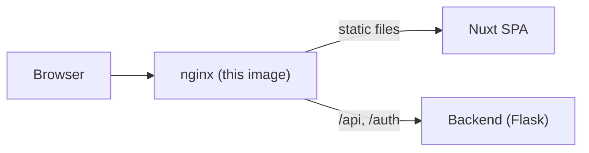
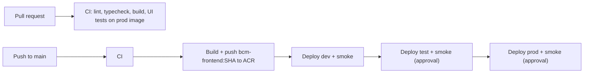

# BCM Tools — Frontend

Nuxt 4 single-page app for BCM Tools, built with Nuxt UI. In production it is served by nginx, which also forwards `/api/*` and `/auth/*` to the backend, so the browser only ever talks to one origin.

The backend (Flask API, Microsoft sign-in, Graph, MySQL) lives in a separate repository (`bcm-backend`).

---

## Contents

- [Tech stack](#tech-stack)
- [How it fits together](#how-it-fits-together)
- [Project structure](#project-structure)
- [Getting started](#getting-started)
- [Scripts](#scripts)
- [Configuration](#configuration)
- [Authentication in the frontend](#authentication-in-the-frontend)
- [Building pages](#building-pages)
- [SCCA](#scca)
- [RA](#ra)
- [Testing](#testing)
- [Docker images and nginx](#docker-images-and-nginx)
- [CI/CD](#cicd)
- [Azure setup](#azure-setup)
- [Compatibility with the backend](#compatibility-with-the-backend)
- [Troubleshooting](#troubleshooting)

---

## Tech stack

| Concern | Choice |
|---|---|
| Framework | Nuxt 4 (Vue 3, TypeScript), client-side rendering only (`ssr: false`) |
| UI | Nuxt UI 4 (Tailwind CSS 4), themed by the [design system](docs/design-system.md) |
| Font | Inter, self-hosted via `@fontsource-variable/inter` (no Google Fonts) |
| Icons | Lucide, bundled locally via `@iconify-json/lucide` (no runtime calls to the Iconify API) |
| State | `useState` composables (add Pinia when state grows) |
| Tests | Playwright |
| Production server | nginx (`nginxinc/nginx-unprivileged`, non-root, port 8080) |

## How it fits together



- The app is pre-built into static files (`nuxt generate`). There is no Node server in production.
- All data comes from the backend over `/api/*`. The frontend never calls Microsoft Graph and never holds tokens; it relies on the backend's `HttpOnly` session cookie.
- Sign-in and sign-out are full-page navigations to `/auth/login` and `/auth/logout`, which the backend handles.
- Locally, the Nuxt dev server does the same proxying that nginx does in production.

## Project structure

```text
frontend/
├── app/
│   ├── app.vue                    # Root: <UApp><NuxtLayout><NuxtPage /></NuxtLayout></UApp>
│   ├── app.config.ts              # Nuxt UI theme: colour aliases, compact tables
│   ├── error.vue                  # Full-page error screen (404, unhandled errors)
│   ├── assets/css/main.css        # Design tokens: CIMB palette, chart palette, Inter, motion
│   ├── components/
│   │   ├── AppLogo.vue            # CIMB Niaga logo + "BCM Tools", links home from the top bar
│   │   ├── AppPage.vue            # Page wrapper: top bar with actions slot and user menu
│   │   ├── UserMenu.vue           # Avatar + name dropdown: Profile, Sign out
│   │   ├── StatusBadge.vue        # Renders a value from a status scale (label, colour, icon)
│   │   ├── ProfileFields.vue      # Label/value list used on the profile page
│   │   └── scca/                  # One Scca*Form.vue per editor tab, SccaMatrix, SccaReportDownloads
│   ├── composables/
│   │   ├── useAuth.ts             # Current user, fetchUser(), hasRole()
│   │   ├── useProfile.ts          # GET /api/me/profile (Microsoft profile saved at sign-in); photo at /api/me/photo
│   │   └── useScca.ts             # SCCA types, list/detail fetchers, mutations, report URLs, 422 field errors
│   ├── layouts/default.vue        # App shell. Pages use AppPage: top bar, then content
│   ├── middleware/auth.global.ts  # Redirects to /login unless the page is public
│   ├── pages/
│   │   ├── index.vue              # Home: welcome, then the module menu (requires sign-in)
│   │   ├── profile.vue            # The user's Microsoft profile from the backend's users table
│   │   ├── login.vue              # Public sign-in page (no layout); shows sign-in errors and sign-out confirmation
│   │   └── scca/                  # Assessment list, create, tabbed editor, print-friendly report
│   ├── types/page-meta.d.ts       # Adds `public` to definePageMeta
│   └── utils/                     # Auto-imported: format.ts (id-ID dates/numbers/Rp, WIB), chart.ts, status.ts,
│                                  # scca.ts (SCCA constants, gap checks, workbook notes)
├── docs/design-system.md          # Design system spec: tokens, components, accessibility, writing style
├── public/                        # Copied as-is: cimb-niaga-logo.svg, favicon.ico
├── e2e/
│   ├── ui/                        # Playwright tests with the API mocked
│   └── smoke/                     # Playwright tests against a real backend
├── nginx/default.conf.template    # Production nginx config (BACKEND_URL injected at start)
├── .github/workflows/             # ci.yml, deploy.yml, deploy-env.yml
├── compose.yaml                   # Local dev server with hot reload
├── Dockerfile                     # Targets: dev, build, prod
├── eslint.config.mjs              # ESLint (rules and code style set in nuxt.config.ts)
├── nuxt.config.ts
├── playwright.config.ts
├── .editorconfig, .nvmrc          # Editor settings; Node version used by CI
├── .env.example                   # Dev-only environment variables
└── package.json
```

### Naming conventions

| What | Convention | Example |
|---|---|---|
| Components | `PascalCase.vue`; a feature folder's components start with the feature name, so Nuxt's auto-import name is the file name | `components/scca/SccaRatingForm.vue` → `<SccaRatingForm>` |
| Tab or edit forms | `<Feature><Thing>Form.vue` | `SccaInterdependencyForm.vue` |
| Composables | `use<Feature>.ts`, one per feature | `useScca.ts` |
| Utils | lower-case feature or concern name | `utils/scca.ts`, `utils/format.ts` |
| Pages and routes | lower-case, nested by feature; `[id]` for a record | `pages/scca/[id]/report.vue` → `/scca/1/report` |
| Constants | `SCREAMING_SNAKE_CASE`, prefixed with the feature | `SCCA_DEPLOYMENT_MODELS` |
| UI tests | `e2e/ui/<feature>.spec.ts`; mocks in `e2e/fixtures/<feature>.ts` | `e2e/ui/scca.spec.ts` |

Values sent to the API (deployment model, business hours, recovery hours, ...) are the same lists as the backend's `app/models/scca.py`; keep both in step. All text files use LF line endings (`.gitattributes`).

Pages use `layouts/default.vue` and wrap their content in `<AppPage title="...">`, unless they opt out with `definePageMeta({ layout: false })`, as `login.vue` does.

**Before building UI, read [`docs/design-system.md`](docs/design-system.md).** It defines colours, typography, spacing, and how to use buttons, forms, tables, feedback, status badges, KPI tiles, charts and navigation.

## Getting started

### Prerequisites

- Docker Desktop, **or** Node.js 24.11+ (`.nvmrc`; 22.21+ also works) with npm 11.5+. Docker and CI use Node 24; use npm 11 locally too, because npm 10's `npm ci` rejects lockfiles written by npm 11.
- The backend running locally on port 8000 (see the backend README)

> npm 11.4 has a bug that crashes `npm install` on this project (`Cannot read properties of null (reading 'edgesOut')`). Upgrade with `npm install -g npm@latest`, or run `npx npm@latest install`.

### Option A: Docker (recommended)

1. Start the backend stack (in the backend repository): `docker compose up`
2. Start the frontend:

   ```powershell
   docker compose up --build
   ```

3. Open <http://localhost:3000>. You'll be redirected to the login page; **Sign in with Microsoft** goes through the backend to Entra ID.

Source is bind-mounted, so edits hot-reload. File watching uses polling (`CHOKIDAR_USEPOLLING=true`) because Docker Desktop on Windows doesn't forward file-change events from the host.

The container reaches the backend at `http://host.docker.internal:8000`, so the backend can run in Docker or directly on your machine.

### Option B: Node on your machine

```powershell
npm install
npm run dev
```

The dev server runs on <http://localhost:3000> and proxies `/api` and `/auth` to `http://localhost:8000`. Point it elsewhere with `NUXT_DEV_BACKEND_URL`:

```powershell
$env:NUXT_DEV_BACKEND_URL = "http://localhost:8001"; npm run dev
```

## Scripts

| Command | What it does |
|---|---|
| `npm run dev` | Dev server with hot reload on port 3000 |
| `npm run build` | Static production build into `.output/public` (`nuxt generate`) |
| `npm run preview` | Preview the production build |
| `npm run lint` | ESLint, including code style (`npm run lint:fix` to auto-fix) |
| `npm run typecheck` | Type-check the app (`vue-tsc`) |
| `npm run test:e2e` | Playwright UI tests (API mocked) against `E2E_BASE_URL` |
| `npm run test:smoke` | Playwright smoke tests against a real backend at `E2E_BASE_URL` |

## Configuration

The built app has no environment-specific settings: the same image runs in every environment because all API calls are relative (`/api/...`). Environment differences live in nginx and the backend.

| Variable | Where | Default | Purpose |
|---|---|---|---|
| `BACKEND_URL` | Production container (runtime) | — (required) | Where nginx forwards `/api` and `/auth`, e.g. `https://bcm-api-prod.azurewebsites.net`. Scheme and host only, no path. |
| `APP_VERSION` | Docker build arg | `dev` | Written to `/version.json`; the deploy pipeline uses it to detect the new release. |
| `NUXT_DEV_BACKEND_URL` | Dev server | `http://localhost:8000` | Backend for the dev proxy. |
| `CHOKIDAR_USEPOLLING` | Dev server | unset | `true` to poll for file changes (needed for Docker on Windows). |
| `E2E_BASE_URL` | Playwright | `http://localhost:3000` | Site under test. |

## Authentication in the frontend

The backend owns authentication. The frontend only needs to know who the user is.

### `useAuth()`

```ts
const { user, fetchUser, hasRole } = useAuth()

user.value            // { id, name, email, roles } or null
await fetchUser()     // GET /api/me; sets user to null on 401, rethrows other errors
hasRole('BCM.Admin')  // true if the user has any of the given roles
```

### Route guard

`app/middleware/auth.global.ts` runs before every route. If no user is loaded it calls `/api/me`; on 401 it redirects to `/login?redirect=<original path>`. The login button sends that path to the backend as `next`, so users land back where they started after signing in.

Pages are protected by default. Make a page public with:

```vue
<script setup lang="ts">
definePageMeta({ public: true })
</script>
```

### Sign-in and sign-out

Sign-out ends only the BCM Tools session; the browser stays signed in to Microsoft. The backend then redirects to `/login?signed_out=1`, which shows a confirmation.

Use plain links — they must be full-page navigations, not client-side routes:

```vue
<UButton to="/auth/login" external label="Sign in with Microsoft" />
<UButton to="/auth/logout" external label="Sign out" />
```

### Role-based UI

```vue
<UButton v-if="hasRole('BCM.Admin')" label="Delete plan" color="error" />
```

Hiding UI is for usability only. The backend enforces every permission with `@require_role`.

## SCCA

System Criticality Categorisation Assessment, matching the workbook *SCCA Tools V4.2 for CIMB Niaga*. The list, editor and report call `/api/scca/*`. The list is **server-paginated**: search `q`, category, `page` and `per_page=25` are sent as query parameters and kept in the URL.

The editor has five tabs, one per part of the workbook. Each tab is one form component in `components/scca/`:

| Tab | Workbook sheet | Component |
|---|---|---|
| Application | `SCC_Rating` header, `SCC_Result` application details | `SccaDetailsForm.vue` |
| Rating | `SCC_Rating` (18 questions, guides, justification) | `SccaRatingForm.vue` |
| Interdependencies | `A3 Interdependency` | `SccaInterdependencyForm.vue` |
| Recovery | `SCC_Result` recovery blocks | `SccaRecoveryForm.vue` |
| Result and sign-off | `SCC_Result` scores, upgrade/downgrade, 8 sign-offs | `SccaResultForm.vue` |

**Scoring stays on the backend.** The Rating tab previews through `POST /api/scca/calculate` and shows C, I, A, CIA with its level (`5-CIA`), Potential Loss with its level (`4-PoLoss`) and the category, the same figures as the workbook. The workbook's notes on C1 (C5 and P4 follow a Critical C1), A3 (highest category among *Full* dependencies) and I4 (number of interfaces) appear as warnings under those questions; like the workbook, they don't block saving (`ratingNoteWarnings()` in `utils/scca.ts`).

**Reports.** The assessment and report pages have **Download PDF** and **Download Excel** (`SccaReportDownloads.vue`). They link to `GET /api/scca/assessments/{id}/report.pdf` and `.xlsx`: the backend fills the official workbook (formulas, charts and tick boxes kept) and lays out the PDF like the workbook's print. Downloads contain the saved assessment, so save the current tab first.

## RA

Risk Assessment of a work location, matching the workbook *HO Risk Assessment Location – Version 2025 – r4* (the LRP scorecard). **RA Branch** (`/ra-branch`) is the same module for branches, from the workbook *Risk Assessment Location – Version 2025-2026 – Cabang rev4*. Pages call `/api/ra/*`, with `?kind=branch` on the formula and list calls for RA Branch:

| Page | Purpose |
|---|---|
| `/ra` | Assessment list, server-paginated, with search, location, period and highest-residual filters kept in the URL. **View locations** and **New assessment** sit in the toolbar right above the table |
| `/ra/locations` | Register of buildings; a row opens the location page. Delete only while a location has no assessments |
| `/ra/locations/new` | Add a building (name, address), then continue on its page. Opened from **New assessment** with `?then=assessment`, it returns there with the new location chosen |
| `/ra/locations/{id}` | The location and its **building profile**, shared by every RA cycle: **Details** (name, address, active, and its assessments), **Map** (its pin), **Emergency contacts** (LRP Section B), **Occupants** (LCP Sections C and F), **Recovery team**, **Call tree** |
| `/ra/new` | New assessment for a location and period, with the location incident team (LIC and LICOM, name and mobile, all required), optionally starting from the previous assessment of that location (which also fills in its team) |
| `/ra/{id}` | Tabbed editor for one RA cycle: **Details** (dates, the required LIC and LICOM, link to the location profile), **Hazards** (the 33-hazard questionnaire), **Heat map and summary** (gross and residual heat maps, residual risk tiles and table), **Sign-off** (the approval workflow below) |

The Hazards tab has a **How to fill in the questionnaire** button that opens the workbook's Lampiran reference tables in a dialog with one tab each: **Historical**, **Probability**, **Impact** (monetary and non-monetary) and **Mitigation** (suggested strategies) (`RaGuideModal.vue`). It starts with the six hazard groups (the workbook's categories, each with how many of its hazards are rated); picking a group lists its hazards next to the selected hazard's form, because 33 hazards × 11 ratings don't fit a table. **Next hazard** moves on into the next group. Ratings are `N/A` or 1–5 with the workbook's guidance under each field. Levels update while you type through `raRateHazard()` in `utils/ra.ts`, a mirror of the backend calculator; the saved result always comes from the backend. **Save ratings** sends only the hazards that changed. Issues (an empty rating, missing mitigation) show on the hazard and keep the assessment a draft, but never block saving. A hazard name in a heat map or the summary table opens it on the Hazards tab (`?tab=hazards&hazard=H03`).

**Building profile.** Emergency contacts and the Location Continuity Plan (LCP) sheets describe the building, not one year's assessment, so they are edited on the location page and every assessment of that location uses them. Sections C (building occupants) and F (business continuity strategy) describe the same units, so they are one list with two views on the **Occupants** tab: *Building occupants* (floor, directorate, employees, disability, pregnant, shifts) and *Continuity strategy* (MTD, BCP, alternate site). Units are added and edited in a dialog (`RaOccupantModal.vue`) and each change is saved straight away. The **Recovery team** and **Call tree** tabs use one grouped row editor (`RaGroupedRowsForm.vue`): a card per team or call-tree level, a row per person, saved with one button. Rows left empty are dropped; a row with details needs a name.

**Maps.** A location's pin (latitude and longitude) belongs to the location, like its other profile data, so every RA cycle shows the same place. The location page has a **Map** tab (`RaLocationMapTab.vue`): click the map to place the pin, drag it, or paste the coordinates Google Maps copies (`-6.271633, 106.719358`); links open the pin, or a search for the address, in Google Maps to help find the spot. The location register has a **Table / Map** switch (`?view=map`, `RaLocationsMap.vue`): one pin per location coloured by the highest residual risk of its latest assessment (`RA_PIN_CLASS`), a legend, the same locations as a list, and the locations that still need a pin. On the RA (head office) register, **Show nearby branches (within 5 km)** (`?nearby=branches`) loads the active RA Branch branches and adds those within 5 km of any building (`RA_NEARBY_RADIUS_KM`, haversine distance in `raDistanceKm`) as square markers, with a dashed 5 km ring around each building; a list gives each branch's distance to its nearest building, and a selected building lists every branch within 5 km of it. Branches without a map pin can't be placed and are counted instead. An assessment's Details tab shows the pin read-only in its location card, with a link to the Map tab when there is none. All maps use `RaMap.vue`, a thin wrapper around [Leaflet](https://leafletjs.com) 1.9 that loads Leaflet only when a map is shown. Tiles come from the server set in the backend (`GET /api/ra/map-settings`, `MAP_TILE_URL`; OpenStreetMap by default), so changing provider needs no frontend build; if tiles can't load (e.g. a blocked network) the map says so and pins still work. e2e tests serve a blank tile from a mocked path.

**Sign-off.** The Sign-off tab runs the approval workflow (`RaSignoffForm.vue`): while the assessment is a draft, each role gets a signer picked from the BCM Tools users (`RaSignerSelect.vue`) and a designation (their job title by default); **Submit for sign-off** needs every hazard rated without open issues and every signer chosen. The signers then approve one after another; the current signer (or a BCM.Admin, "on their behalf") sees **Approve** with an optional comment and **Return for changes**, which asks for a comment (`RaReturnModal.vue`) and sends the assessment back to draft. While in sign-off or approved, the Details and Hazards tabs are read-only and a banner says who is up next. Statuses use `raStatus` (Draft, Returned, In sign-off, Approved); the list filters by status, including **Waiting for my sign-off** (`?status=awaiting` → `awaiting=me`). The action plan of a hazard is optional.

**RA Branch** uses the same screens under `/ra-branch` (`/ra-branch/locations`, `/ra-branch/new`, `/ra-branch/{id}`): the page components live in `app/components/ra/Ra*Page.vue` and the thin pages in `pages/ra/` and `pages/ra-branch/` render them; `useRaModule()` picks `RA_MODULES.head_office` or `RA_MODULES.branch` from the route. Differences:

- The register is of **branches**, each with a required **region**, and keeps only the emergency contacts (no LCP tabs).
- A hazard has one risk: **Probability** (historical occurrence and probability of occurrence; the higher one counts), the existing mitigation, and the **Impact after mitigation** (the highest of the four impacts), giving one risk rating from the branch matrix. There is no gross risk and only the residual heat map. Existing mitigation is needed for every applicable hazard.
- The LIC is the BOSM and the LICOM the NRSOH; the sign-off is **Prepared by** (BOSM), **Approved by** (branch manager) and **Reviewed by** (NRSOH).
- References are `RAB-<period>-NNNN`. A branch assessment opened under `/ra` moves to `/ra-branch` (and the reverse).

The e2e fixtures in `e2e/fixtures/ra/` were recorded from the backend with the Griya CIMB Niaga 2 sample of the workbook; the `branch-*.json` fixtures with a branch (KCP Bogor Pajajaran) rated on the branch formula. `e2e/ui/ra-branch.spec.ts` covers RA Branch.

## Building pages

### Calling the API

Use `$fetch` with relative URLs; the session cookie is sent automatically because everything is same-origin.

```ts
interface Plan { id: number; name: string }

const plans = await $fetch<Plan[]>('/api/plans')
await $fetch('/api/plans', { method: 'POST', body: { name: 'Data centre outage' } })
```

In components, `useFetch` gives you reactive loading and error state:

```vue
<script setup lang="ts">
const { data: plans, status, error, refresh } = await useFetch<Plan[]>('/api/plans')
</script>
```

If a session expires mid-use, API calls return 401. The route guard handles it on the next navigation; for long-lived screens, catch 401 and send the user to `/login`.

### Nuxt UI

Components are auto-imported with the `U` prefix (`UButton`, `UCard`, `UTable`, `UForm`, `UModal`, ...). See the [Nuxt UI docs](https://ui.nuxt.com/docs). Forms pair well with Zod for validation.

Icons use the Lucide set, bundled at build time so they work without internet access:

```vue
<UIcon name="i-lucide-shield-alert" />
<UButton icon="i-lucide-plus" label="New plan" />
```

To use another icon set, install its `@iconify-json/<set>` package — don't rely on the online Iconify API, which is blocked in the private network.

Every icon is compiled into the client bundle (`icon.clientBundle.scan` in `nuxt.config.ts`), because the static build has no `/api/_nuxt_icon` endpoint and nginx would send that path to the backend. Write icon names as literal strings (`'i-lucide-house'`) so the build can find them; names assembled at runtime won't be bundled.

## Testing

Playwright tests are split into two projects:

| Project | Folder | Backend | Runs in |
|---|---|---|---|
| `ui` | `e2e/ui/` | Mocked in the browser with `page.route` | CI on every pull request |
| `smoke` | `e2e/smoke/` | Real | After every deployment, and locally against the full stack |

### Running locally

```powershell
npx playwright install chromium        # first time only

# UI tests: need only the frontend on :3000 (dev server or prod image)
npm run test:e2e

# Smoke tests: need frontend + backend
npm run test:smoke

# Against a deployed environment
$env:E2E_BASE_URL = "https://bcm-dev.example.co.id"; npm run test:smoke

# Debugging
npx playwright test --project=ui --ui
npx playwright show-report
```

### Writing UI tests

Mock the backend so tests are fast and don't need Entra:

```ts
test('admins see the delete button', async ({ page }) => {
  await page.route('**/api/me', (route) =>
    route.fulfill({ json: { id: 'u1', name: 'Admin', email: 'a@example.com', roles: ['BCM.Admin'] } }),
  )
  await page.route('**/api/plans', (route) => route.fulfill({ json: [{ id: 1, name: 'Plan A' }] }))

  await page.goto('/plans')
  await expect(page.getByRole('button', { name: 'Delete plan' })).toBeVisible()
})
```

Prefer role- and text-based locators (`getByRole`, `getByText`) over CSS selectors.

Smoke tests must not depend on a signed-in user: real Entra sign-in (MFA, conditional access) can't be automated reliably.

## Docker images and nginx

`Dockerfile` targets:

| Target | Base | What it does |
|---|---|---|
| `dev` | `node:24-alpine` | `nuxt dev` on port 3000 (used by `compose.yaml`) |
| `build` | `node:24-alpine` | `npm ci`, `nuxt generate`, writes `version.json` |
| `prod` | `nginxinc/nginx-unprivileged:1.27-alpine` | Serves `.output/public` on port 8080 as a non-root user |

Run the production image locally against a backend on your machine:

```powershell
docker build --target prod --build-arg APP_VERSION=local -t bcm-frontend .
docker run --rm -p 3000:8080 --add-host host.docker.internal:host-gateway `
  -e BACKEND_URL=http://host.docker.internal:8000 bcm-frontend
```

### nginx behaviour (`nginx/default.conf.template`)

- **SPA fallback**: unknown paths serve `index.html`, so deep links work. Pre-rendered pages such as `/login` are served from `login/index.html` directly.
- **Relative redirects** (`absolute_redirect off`): nginx never builds redirects with its internal port 8080.
- **Proxy**: `/api/*` and `/auth/*` go to `BACKEND_URL`. The upstream `Host` header is the backend's own host (required by App Service routing), with the original host in `X-Forwarded-Host`. SNI is enabled for HTTPS upstreams. `X-Forwarded-Proto` is passed through from the load balancer.
- **Compression**: gzip for JS, CSS, JSON and SVG over 1 KB.
- **Caching**: hashed assets under `/_nuxt/` are cached for 1 year; HTML and `version.json` are `no-cache`, so a new release is picked up immediately.
- **Security headers**: `X-Content-Type-Options: nosniff`, `X-Frame-Options: DENY`, `Referrer-Policy: strict-origin-when-cross-origin`.
- **Upload limit**: 20 MB request bodies.

`BACKEND_URL` is substituted when the container starts (nginx's built-in template processing). nginx resolves the backend hostname once at startup, so restart the frontend if the backend's address changes.

## CI/CD



| Workflow | Trigger | What it does |
|---|---|---|
| `ci.yml` | Pull requests; called by `deploy.yml` | `npm ci`, lint, typecheck, build; then builds the **prod** image, runs it, and runs the Playwright `ui` project against it |
| `deploy.yml` | Push to `main`, manual | Runs CI, builds the image once, tagged with the commit SHA, pushes to ACR, then promotes the **same image** through `dev`, `test`, `prod` |
| `deploy-env.yml` | Called per environment | Points the App Service at the new image, waits until `APP_URL/version.json` reports the new SHA, then runs the Playwright `smoke` project against `APP_URL` |

### GitHub configuration

Azure login uses OpenID Connect (federated credentials) — no Azure secrets in GitHub.

**Repository variables:**

| Variable | Purpose |
|---|---|
| `AZURE_TENANT_ID` | Tenant of the deployment identity |
| `AZURE_SUBSCRIPTION_ID` | Subscription containing the resources |
| `AZURE_CLIENT_ID` | Identity used by the build job to push to ACR |
| `ACR_NAME` | Container registry name (without `.azurecr.io`) |
| `DEPLOY_RUNNER` | Label of the self-hosted runner inside the VNet (empty = `ubuntu-latest`) |

**Environments** `dev`, `test`, `prod`, each with:

| Variable | Example | Purpose |
|---|---|---|
| `AZURE_CLIENT_ID` | | Deployment identity for this environment |
| `FRONTEND_APP_NAME` | `bcm-web-dev` | App Service name |
| `APP_URL` | `https://bcm-dev.example.co.id` | Public URL of the app, reachable from the runner. Used for the version check and smoke tests; leave empty to skip both |

Protection rules: require reviewers on `test` and `prod`; restrict `prod` to `main`.

The self-hosted runner (shared with the backend repository) needs Docker, Azure CLI, `curl` and Node.js 24, plus the OS libraries Playwright installs with `npx playwright install --with-deps`.

## Azure setup

Per environment:

| Resource | Notes |
|---|---|
| App Service (Linux, container) | e.g. `bcm-web-<env>`. Private endpoint for inbound (reached via Application Gateway); VNet integration for outbound to the backend's private endpoint. |
| Application Gateway with WAF | Public or internal entry point for users; TLS termination; routes to the frontend App Service. Its hostname is the `PUBLIC_BASE_URL` configured on the backend. |

### App Service settings

| Setting | Value |
|---|---|
| `WEBSITES_PORT` | `8080` |
| `BACKEND_URL` | Backend App Service URL, e.g. `https://bcm-api-dev.azurewebsites.net` (resolves to its private endpoint through private DNS) |

Also give the App Service a managed identity with *AcrPull* on the registry, enable managed-identity ACR pull, and set the health check path to `/`.

### Deployment identity

As for the backend: a managed identity per environment with a federated credential for `repo:<org>/<frontend-repo>:environment:<env>` (and `ref:refs/heads/main` for the build identity), with *AcrPush* (build) and *Website Contributor* on the frontend App Service (environments).

## Compatibility with the backend

The two repositories deploy independently, so the frontend must cope with the backend being one release ahead or behind:

- Treat new response fields as optional until the backend that provides them is in `prod`.
- Ship backend changes first (new endpoints/fields), then the frontend that uses them.
- Don't rely on a field being removed; the backend removes fields only after the frontend stops using them.

## Troubleshooting

| Symptom | Cause and fix |
|---|---|
| `npm install` fails with `reading 'edgesOut'` | npm 11.4 bug. Run `npm install -g npm@latest`, or `npx npm@latest install`. |
| Hot reload doesn't pick up changes in Docker | Polling must be enabled (`CHOKIDAR_USEPOLLING=true`, already set in `compose.yaml`). The project folder being synced by OneDrive can also slow down watching. |
| `/api/...` returns 502/504 locally | The backend isn't running on port 8000, or `NUXT_DEV_BACKEND_URL` / `BACKEND_URL` points to the wrong place. |
| Login page loops back to `/login?error=signin_failed` | A backend sign-in problem — check the backend logs and its README's troubleshooting section. |
| Production container exits at start with `host not found in upstream` | nginx can't resolve `BACKEND_URL`. Check the value, and in Azure the private DNS zone for the backend's private endpoint. |
| Production App Service returns 404 from `/api` | The upstream `Host` must be the backend's hostname. Don't override `proxy_set_header Host` in the nginx template. |
| Icons missing | The icon set isn't installed locally. Install `@iconify-json/<set>`. |
| Playwright: `browserType.launch: Executable doesn't exist` | Run `npx playwright install chromium`. |
